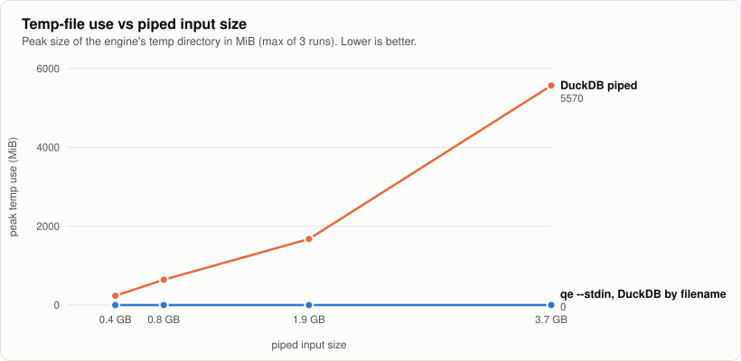
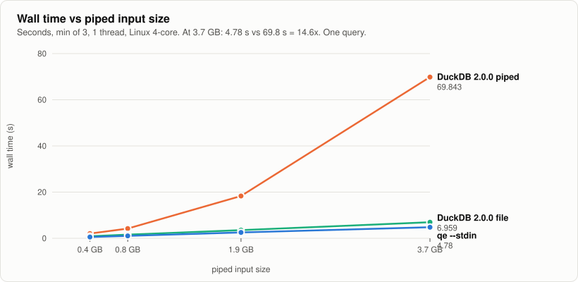
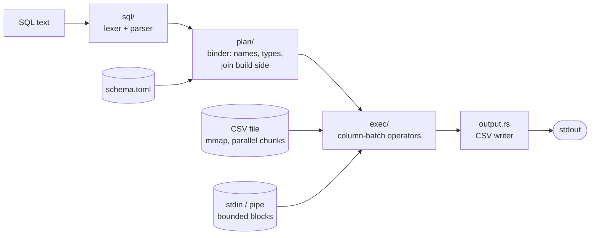
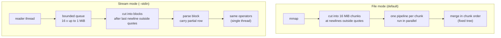

<div align="center">

# qe · SenkoParse

**A from-scratch SQL engine for big CSV files, built to run on a pipe in bounded memory.**

`JOIN` · `GROUP BY` · aggregates over multi-GB CSV · no database or dataframe library inside · Rust

<br>


<sub>Measured, one query, 375 MB to 3.7 GB of piped input. Details, caveats and raw runs: [EXP-005-stream](docs/experiments/005-stream-memory.md).</sub>

</div>

---

## Why this exists

`gunzip -c big.csv.gz | qe --stdin t "SELECT ..."` should run in memory that **does not grow with the input**.

DuckDB issue #25165 reports that `read_csv('/dev/stdin')` buffers piped input and spills it to temp files. We reproduced it (DuckDB 2.0.0, `memory_limit=256MB`, 1 thread) and then measured `qe` on the same kind of query:

| Piped input | `qe --stdin` peak RSS · temp | DuckDB piped peak RSS · temp | DuckDB by filename peak RSS · temp |
|---|---|---|---|
| 1x · 375 MB | **42 MiB** · 0 | 337 MiB · 237 MiB | 216–246 MiB · 0 |
| 2x · 750 MB | **42 MiB** · 0 | 338 MiB · 644 MiB | 234–250 MiB · 0 |
| 5x · 1.9 GB | **42 MiB** · 0 | 341 MiB · 1.7 GB | 229–251 MiB · 0 |
| 10x · 3.7 GB | **42 MiB** · 0 | 346 MiB · **5.6 GB** | 232–245 MiB · 0 |

<sub>3 runs per cell, 4-core Xeon container, both engines on 1 thread. RSS includes a 12.4 MiB measurement floor. The data is **our reconstruction** of the issue's shape, not the issue's own script. The output rows of all three engines are identical at every size.</sub>

<table>
<tr>
<td width="50%"></td>
<td width="50%"></td>
</tr>
</table>

> **What this does and does not show.** It shows that for a streaming join against a small lookup table, input buffering is bounded. It does **not** show that every query is bounded: group tables and join build sides still grow with their own size (see [Limits](#limits)).

---

## At a glance

| | |
|---|---|
| **Headline** | Bounded-memory SQL over non-seekable CSV streams ([ADR-0002](docs/adr/0002-stream-first-direction.md)) |
| **Correctness** | Randomized queries compared with SQLite on 5 engine configurations; 23 tests green; 2 mutation checks ([testing](docs/testing.md)) |
| **File mode speed** | 2.4–5.9x faster than the single-thread baseline on every benchmark query ([performance](docs/performance.md)) |
| **Dependencies** | `memmap2`, `memchr`, `rayon`. SQLite only in tests; DuckDB only in `bench/` |
| **Status** | Streaming tested and measured on **one** query. See the [status board](docs/status.md) for every claim and its evidence |

---

## Quick start

```bash
cargo build --release
python3 scripts/gen_data.py --rows 1e7            # ~1.2 GB into data/ (tables x, small, medium, big + schema.toml)
./target/release/qe --data data/ \
  "SELECT s.id4, SUM(x.v1) FROM x JOIN small s ON x.id1 = s.id1 GROUP BY s.id4 ORDER BY 1"
```

Schema comes from a `schema.toml` next to the CSVs. There is no type sniffing:

```toml
[x]                      # file is x.csv
id1 = "i64"              # i64 | f64 | decimal(N) | str | date
v1  = "f64"
```

Output is CSV with a header; NULL is an empty field. Anything outside the supported SQL fails with a clear error.

### Streaming from a pipe

```bash
gunzip -c big.csv.gz | ./target/release/qe --data data --stdin t "SELECT k, SUM(v) FROM t GROUP BY k"
```

`--stdin t` reads table `t` from stdin; its schema still comes from `data/schema.toml`. Results are written (and flushed) as batches complete.

### Options

| Flag | Meaning | Results depend on it? |
|---|---|---|
| `--data DIR` | directory with the CSVs and `schema.toml` (default `data`) | n/a |
| `--stdin TABLE` | read `TABLE` from stdin instead of `TABLE.csv` | no (same answers as file mode) |
| `--no-opt` | single-threaded reference path, no fast paths | no, it is the oracle |
| `--threads N` | worker threads (default: all cores) | **never** |
| `--chunk-bytes N` | scan chunk (file mode, default 16 MiB) or block target (stream mode, default 4 MiB) | **never** |

---

## How it works



Two ways to read a table, one set of operators:



Full tour: [docs/architecture.md](docs/architecture.md).

### Supported SQL

`SELECT` columns, expressions (`+ - * /`, comparisons) and aggregates `COUNT(*)`, `COUNT(col)`, `SUM`, `AVG`, `MIN`, `MAX`, `COUNT(DISTINCT col)` · `FROM` one or more CSV tables · `[INNER|LEFT] JOIN ... ON a = b [AND c = d]` · `WHERE` with `AND`/`OR`, comparisons, `IS [NOT] NULL` · `GROUP BY` · `HAVING` · `ORDER BY` · `LIMIT`.
Not supported: `SELECT *` / `t.*`, `IN (SELECT ...)`, window functions, anything else.

### Correctness rules the engine enforces

| Topic | Rule |
|---|---|
| NULL | empty field = NULL. `COUNT(col)` skips NULLs, `COUNT(*)` does not. `SUM` of all NULL = NULL. NULL keys never join. All NULL keys form one group |
| CSV | RFC 4180 quoting, commas and newlines inside quotes, `""`, CRLF, header row, missing final newline, BOM, blank lines |
| Stray quotes | a `"` inside an unquoted field is an error on **every** path (it is what makes exact parallel splitting possible) |
| Numbers | integer `SUM` in i128 with an error on overflow; `AVG` is never integer division; decimals are scaled `i64` (exact); `f64` sums are Kahan |
| Determinism | results never depend on `--threads` or `--chunk-bytes` |
| Errors | same text on every path, including the row number; stream mode says `<stdin>` instead of the file path |

---

## Performance


<sub>1e7 rows, 527 MB per table, Apple M3 Pro (11 cores), warm cache. From [BENCHMARKS.md](BENCHMARKS.md).</sub>

The speedups come from a short list of techniques, each with an experiment that was written before the code, including the ones that did not pay off. Read [docs/performance.md](docs/performance.md) for the catalog: skipping unread fields, exact parallel chunking, fixed-order merges, inline integer keys, partition-wise merge, allocation-free output, and what was measured to be *not* worth it.

---

## Tests

```bash
cargo test                                          # 23 tests, ~45 s (debug)
cargo test --release --test difftest -- --ignored  # large randomized run (slow; see docs/testing.md)
```

| Layer | What it proves | Oracle |
|---|---|---|
| `tests/difftest.rs` | random data and random queries match SQLite on **5** configurations: default, `--no-opt`, 3 threads with 256-byte chunks, and two stream configurations (1–300 byte reads, 37-byte blocks) | SQLite |
| `tests/stream.rs` | stream mode equals file mode for every block size 1–70, byte-at-a-time reads, quoted newlines, CRLF, BOM, joins, errors, `LIMIT` on an endless stream | file mode |
| `tests/parallel.rs` | exact chunk splitting, bit-identical floats across thread counts, canonical errors, partitioned merge | `--no-opt` |
| `tests/edge_cases.rs` | NULL, overflow, decimals, quoting, loud errors | hand-written expectations |

The tests are documented in the same format as the experiments (claim, method, oracle, result, falsification evidence, threats to validity): [docs/testing.md](docs/testing.md).

---

## Status

| Area | State | Evidence |
|---|---|---|
| File-mode correctness vs SQLite | ✅ green on all file configurations | [TEST-002](docs/testing.md) |
| Parallel scan, thread-count independence | ✅ done (M2) | [EXP-003](docs/experiments/003-parallel-chunked-scan.md) |
| Integer-key aggregation | ✅ done, merged | [EXP-004](docs/experiments/004-integer-key-aggregation.md) |
| Streaming correctness (`--stdin`) | ✅ tested vs file mode and SQLite | [TEST-002, TEST-004, TEST-005](docs/testing.md) |
| Streaming memory | ✅ measured on **one** query and one reconstructed data shape | [EXP-005-stream](docs/experiments/005-stream-memory.md) |
| 1e7 x 1e7 join | 🟡 1.5 s; the build is serial (deferred) | [performance](docs/performance.md) |
| Bit-identical `f64` sums, stream vs file | ⚪ not tested (tolerance 1e-9 only) | [status](docs/status.md) |
| High-cardinality GROUP BY over a stream | ⚪ not measured (not bounded by design) | [status](docs/status.md) |
| Cold cache, DuckDB speed comparison on file mode, spill to disk | ⚪ not measured / not implemented | [status](docs/status.md) |

The complete list of claims, their evidence and open items is on the [status board](docs/status.md).

---

## Limits

- The stream is parsed on **one thread** (file mode is parallel).
- No `IN (SELECT ...)`. Use `JOIN`, which equals a semi-join only if the lookup keys are unique.
- The stream cannot be the right side of a `LEFT JOIN`, is never a join build side, and can be scanned once per query.
- "Bounded" covers **input buffering**. A group table grows with the number of groups, and a join build side with its size.
- A single row longer than 64 MiB is an error in stream mode.
- `SELECT *` and `t.*` are not supported; list the columns.

---

## Repository map

```
crates/engine/src/
  sql/        lexer, parser, AST
  plan/       binder (names, types), join build-side choice
  exec/       scan, filter, project, hash_agg, hash_join, sort, limit, par (chunk-parallel driver)
  storage/    csv/ (field scanner, number parsers, chunker, stream.rs), catalog (schema.toml)
  types/      values, NULL bitmaps, decimal as scaled i64
crates/cli/   the `qe` binary
tests/        difftest.rs (vs SQLite), stream.rs, parallel.rs, edge_cases.rs, common/
bench/        run.py, exp.py, exp005_stream.py, gen_stream_data.py, make_charts.py, ...
docs/         architecture, performance, testing, status, ADRs, experiments
```

## Docs

| Read this | When |
|---|---|
| [docs/README.md](docs/README.md) | to pick a reading path |
| [docs/architecture.md](docs/architecture.md) | to understand how a query runs |
| [docs/performance.md](docs/performance.md) | for the tuning techniques and what they bought |
| [docs/testing.md](docs/testing.md) | for what each test proves and how it was falsified |
| [docs/status.md](docs/status.md) | for every claim, its evidence and what is open |
| [docs/adr/](docs/adr/) | for decisions: [0001 parallel and fast paths](docs/adr/0001-parallel-and-fast-path-execution.md), [0002 stream-first](docs/adr/0002-stream-first-direction.md) |
| [docs/experiments/](docs/experiments/) | for raw hypotheses, numbers and decisions |
| [BENCHMARKS.md](BENCHMARKS.md) | for every benchmark table |
| [CLAUDE.md](CLAUDE.md) | for the project rules and working style |
