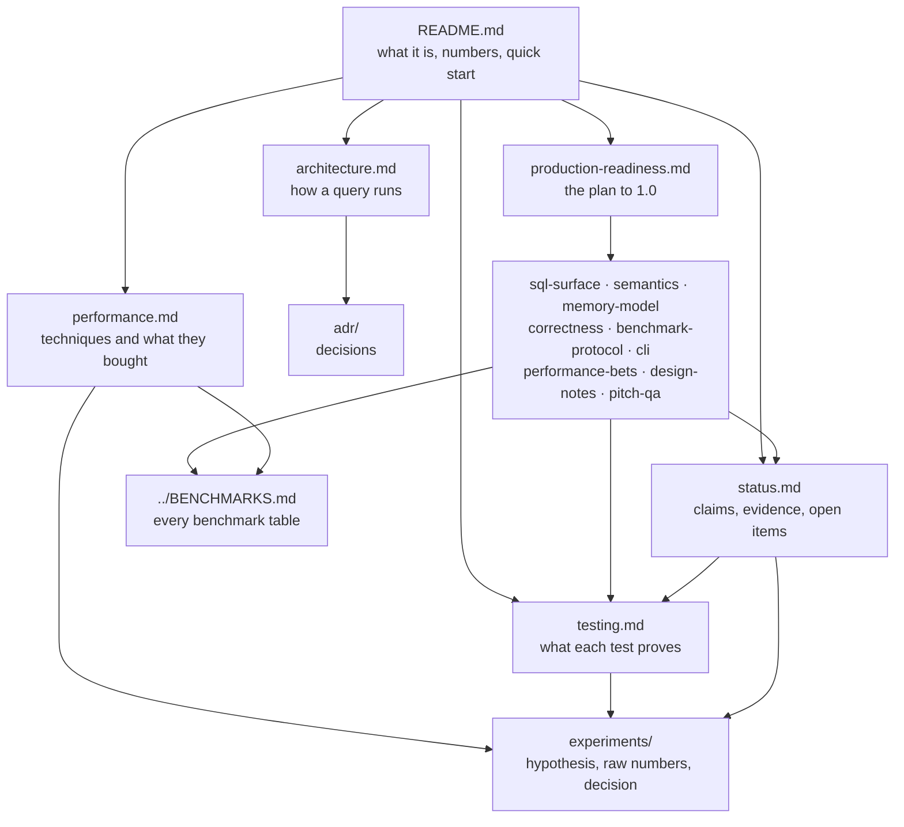

# Documentation

## Reading paths

| You are | Read in this order |
|---|---|
| **New here** | [README](../README.md) → [architecture](architecture.md) → [status](status.md) |
| **Checking a claim** | [status](status.md) (claims ledger) → the linked experiment → [testing](testing.md) |
| **Tuning performance** | [performance](performance.md) → [experiments/](experiments/) → [BENCHMARKS](../BENCHMARKS.md) |
| **Changing the scanner or the stream code** | [architecture](architecture.md) → [testing](testing.md) (invariants, falsification log) → [ADR-0002](adr/0002-stream-first-direction.md) |
| **Adding a test** | [testing: template](testing.md#template) |
| **Adding an experiment** | [experiments/README.md](experiments/README.md) (template and rules) |
| **Planning work toward 1.0** | [production-readiness](production-readiness.md) → [sql-surface](sql-surface.md) → [memory-model](memory-model.md) |
| **Adding a SQL feature** | [sql-surface](sql-surface.md) (definition of done) → [semantics](semantics.md) → [correctness](correctness.md) |
| **Running or publishing a benchmark** | [benchmark-protocol](benchmark-protocol.md) → [performance-bets](performance-bets.md) → [BENCHMARKS](../BENCHMARKS.md) |
| **Presenting the project** | [pitch-qa](pitch-qa.md) → [status](status.md) |

## Index

| Document | What is in it |
|---|---|
| [architecture.md](architecture.md) | layers, query lifecycle, file mode, stream mode, operators, aggregation, joins, errors, invariants |
| [performance.md](performance.md) | benchmark table, a catalog of seven techniques with measured effect, what did not work, tuning knobs, how to measure |
| [testing.md](testing.md) | test pyramid, five suites written as research (claim, falsifier, method, oracle, result, threats), falsification log, coverage matrix, gaps |
| [status.md](status.md) | milestones, streaming plan, claims ledger, limits, open items |
| [roadmap.md](roadmap.md) | future work as testable hypotheses with targets and falsifiers; the baseline vs DuckDB |
| [adr/0001](adr/0001-parallel-and-fast-path-execution.md) | parallel execution and fast paths after M1 |
| [adr/0002](adr/0002-stream-first-direction.md) | the direction change to bounded-memory streaming |
| [adr/0005](adr/0005-reference-dialect.md) | *Proposed:* SQLite defines the answer for the shared subset, DuckDB for the rest (D-1) |
| [adr/0006](adr/0006-memory-definition.md) | *Proposed:* report anonymous and total RSS; the budget controls anonymous; `pread` under a limit (D-3) |
| [experiments/](experiments/README.md) | EXP-001 to EXP-005-stream and their raw data in `experiments/data/` |
| [production-readiness.md](production-readiness.md) | the plan to 1.0: release criteria, audit of today, requirements, phases, risks, open decisions, scorecard |
| [sql-surface.md](sql-surface.md) | every SQL feature with its state today, priority, oracle and acceptance test; source of the README SQL list |
| [semantics.md](semantics.md) | what a correct answer is: reference dialect, NULL, coercion, arithmetic, ordering, inference, output, determinism, dialect differences |
| [memory-model.md](memory-model.md) | what "memory" means, the budget, accounting, spill design and determinism, file-mode memory, failure behaviour, verification |
| [correctness.md](correctness.md) | oracles, comparison rules, generator, fuzzing, edge-case checklist, deviations register, running totals |
| [benchmark-protocol.md](benchmark-protocol.md) | suites F/S/M, datasets, engines, machines, procedure, pre-registration, reporting, regression gate |
| [performance-bets.md](performance-bets.md) | counterintuitive moves for the losing queries (Q4, Q5, Q8, Q9), each with mechanism and kill rule |
| [cli.md](cli.md) | flags today and proposed, stdout/stderr contract, exit codes, `--stats` schema, compatibility promise |
| [design-notes.md](design-notes.md) | comparable tools and borrowed techniques with sources and licences |
| [pitch-qa.md](pitch-qa.md) | opening, demo order, hostile questions with the phase that makes each answer true, limitations slide |
| [img/](img/) | generated charts (`python3 bench/make_charts.py`) |

## Conventions

- **No number, no claim.** A performance or memory claim needs a before/after number with the query, data size, machine and wall time.
- **Write the hypothesis and the kill threshold before the code**; fill the results after. A negative result is a valid, documented outcome.
- **Link, don't duplicate.** Numbers live in `BENCHMARKS.md` and the experiment files; other pages link to them.
- **Generated figures** come from raw data (`bench/make_charts.py`), so they can be regenerated and checked.
- Dates are 2026-10-31 unless stated; machines are stated next to every number.
