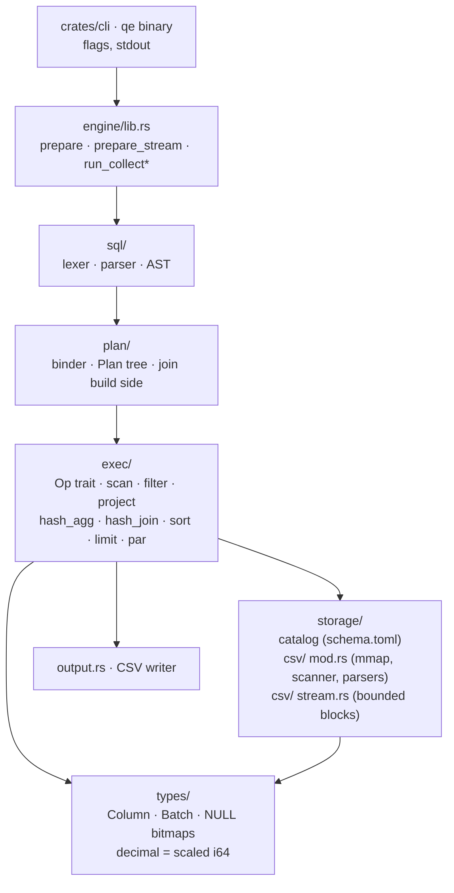
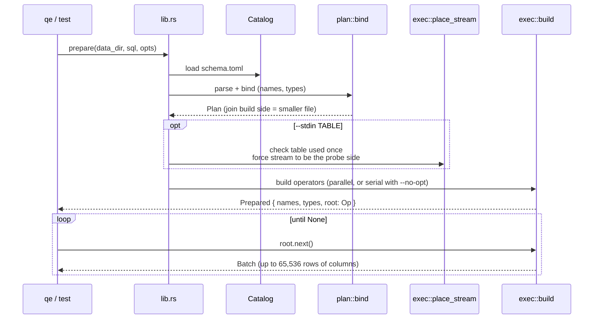
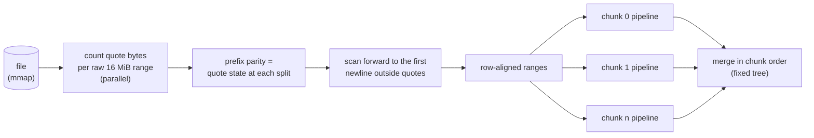
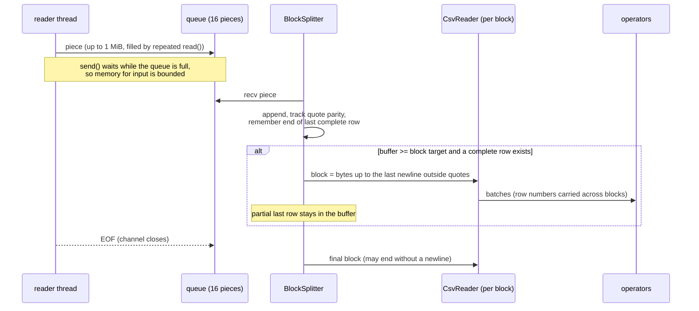
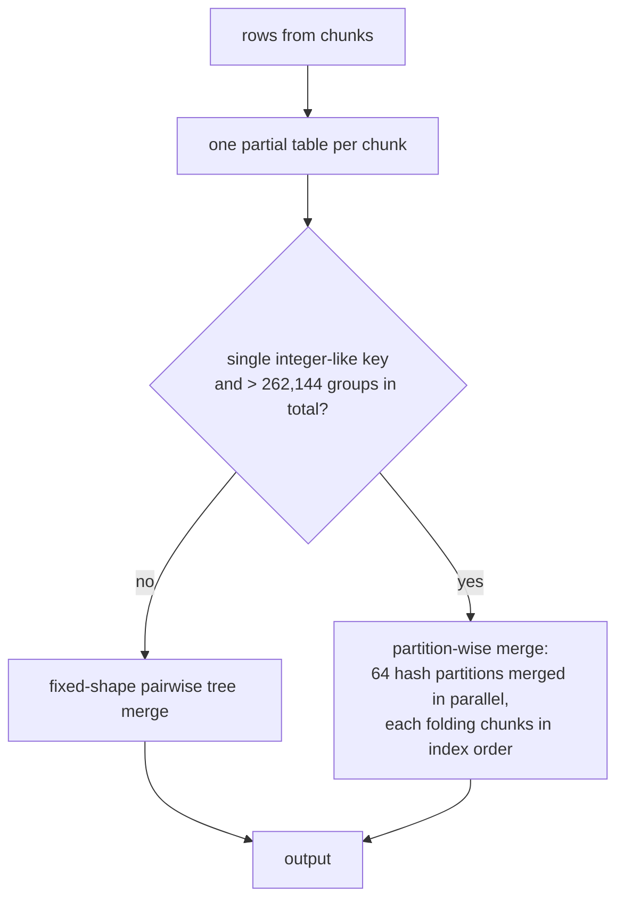

# Architecture

How a query runs, why the pieces look the way they do, and which invariants hold everywhere.
Decisions live in the [ADRs](adr/); measurements in the [experiments](experiments/).

**Contents:** [Layers](#layers) · [Query lifecycle](#query-lifecycle) · [File mode](#file-mode-parallel-chunked-scan) · [Stream mode](#stream-mode-bounded-blocks) · [Operators](#operators) · [Aggregation strategies](#aggregation-strategies) · [Joins](#joins) · [Errors](#errors) · [Invariants](#invariants)

## Layers

**Hard rule:** the engine crate depends on no database or dataframe library. Only `memmap2`, `memchr` and `rayon`. SQLite lives in `tests/`, DuckDB in `bench/`.

## Query lifecycle

- Operators are **pull-based** and process **batches of columns**, not rows. A batch holds up to `BATCH_ROWS = 65,536` rows.
- Only the columns a query references are parsed; the rest are skipped field by field (still quote-aware).
- `--no-opt` builds the **serial reference path**: generic quote-aware scanner, no fast paths. Every other path must match it.

## File mode: parallel chunked scan

**Why the split is exact.** Every `"` byte in valid CSV is structural: `""` toggles the quote state twice, and a `"` inside an unquoted field is rejected. So the quote state at any byte is the parity of the quote bytes before it. A split point is a newline with parity "outside". The ranges depend only on the file and `chunk_bytes`, never on the number of threads.

**Why results never depend on `--threads`.** Chunks have a fixed size, and every merge or emit happens in chunk-index order. So even `f64` sums are bit-identical on any machine. Experiment: [EXP-003](experiments/003-parallel-chunked-scan.md).

**Quote-free fast path.** If a chunk has no `"` byte (one SIMD `memchr`), rows are exactly newline-delimited and fields comma-delimited. The scanner then counts commas per line (to keep ragged-row errors identical), locates only fields up to the last needed column, and jumps to the next newline. [EXP-002](experiments/002-quote-free-fast-path.md).

## Stream mode: bounded blocks

| Piece | Role | Bound |
|---|---|---|
| `spawn_reader` | thread that fills pieces and sends them | queue of 16 pieces, each up to 1 MiB (or the block size if smaller) |
| `BlockSplitter` | appends pieces, tracks quote parity, cuts blocks | one block (default 4 MiB) plus one partial row |
| `StreamScan` | parses the header from the first block, then one `CsvReader` per block | one block |
| row limit | a row longer than 64 MiB is an error | 64 MiB |

Design points:

- **Same parser.** Blocks are parsed by the file-mode `CsvReader` (it now works on any byte buffer, not only a memory map). The row counter is carried across blocks, so error messages carry the **global** row number, identical to file mode.
- **Same cut rule.** The parity rule is the one used by `plan_chunks`. For invalid input with a stray quote, parity is wrong only *after* that quote, and the block containing it is parsed first, so the error is reported at the right row.
- **The stream is always the probe side of a join.** `place_stream` overrides the size-based build-side choice. A build side is held in memory in full and a stream has no known size. For an INNER join, probe and build roles give the same rows.
- **Single scan.** A stream is consumed once; the planner rejects a query that scans the stream table twice.
- **Backpressure and early exit.** When the consumer stops (`LIMIT` satisfied, error), the channel closes and the reader thread exits on its next send.
- **Output is flushed per batch**, so results appear while input is still arriving.

Decision record: [ADR-0002](adr/0002-stream-first-direction.md). Evidence: [EXP-005-stream](experiments/005-stream-memory.md).

## Operators

| Operator | File | Notes |
|---|---|---|
| `Scan` / `StreamScan` | `exec/ops.rs`, `storage/csv/stream.rs` | one `CsvReader` per chunk (file) or per block (stream) |
| `Filter`, `Project` | `exec/ops.rs`, `exec/eval.rs` | evaluate expressions over a whole batch; NULL predicate = row dropped |
| `HashAgg` | `exec/hash_agg.rs` | per-chunk partial tables, merged; see below |
| `HashJoin` / `ProbeOp` | `exec/hash_join.rs` | build side drained once, then probed batch by batch (per chunk in parallel) |
| `Sort` | `exec/ops.rs` | full in-memory stable sort; NULLs first for ASC, last for DESC (SQLite semantics) |
| `Limit` | `exec/ops.rs` | stops pulling its input once satisfied |
| `ParStream` | `exec/par.rs` | runs windows of chunks in parallel, emits batches in chunk order |
| `CanonicalErrors` | `exec/par.rs` | root wrapper that re-derives error text from the reference path |

## Aggregation strategies

- Group keys that are `i64`, decimal or date use an **inline integer-key table** (no per-row allocation); other keys use a byte-slice table.
- Both strategies are deterministic for any thread count. Trade-off, stated in [EXP-004](experiments/004-integer-key-aggregation.md): with the partitioned merge, the order of groups in an unordered result is partition order instead of first-seen order. SQL gives no order without `ORDER BY`, and tests compare unordered results as multisets.
- Knob: `Options::agg_partition_groups` (tests set `0` to force the partitioned path).

## Joins

- `[INNER|LEFT] JOIN ... ON a = b [AND c = d]`: equality keys only.
- The **build side** is the smaller input for an INNER join (estimated from file size); a LEFT JOIN always builds the right side.
- NULL keys never match.
- Probe runs per chunk in parallel against one shared, read-only table. The table build itself is serial today (the reason the 1e7 × 1e7 join is the slowest benchmark query).
- In stream mode the stream is forced to the probe side (see above).

## Errors

- Every path reports the **same error text**, including row numbers. Errors found by the parallel path are re-derived by running the serial reference path (`CanonicalErrors`).
- With a stream, the replay uses an empty stream (it cannot be re-read); an error from the stream itself is already produced serially and is returned as is.
- Examples: `row 502`, `unexpected quote inside an unquoted field`, `unterminated quoted field`, `expected N fields, found M`. In stream mode the path is shown as `<stdin>`.

## Invariants

These hold on every path and are enforced by tests ([testing](testing.md)):

| # | Invariant | Enforced by |
|---|---|---|
| 1 | Results equal the `--no-opt` reference | difftest, parallel, stream tests |
| 2 | Results do not depend on `--threads` or `--chunk-bytes` | `parallel.rs` |
| 3 | Stream mode equals file mode (apart from `<stdin>`) | `stream.rs`, difftest stream configurations |
| 4 | NULL semantics: empty = NULL, `COUNT(*)` vs `COUNT(col)`, NULL keys never join | `edge_cases.rs`, difftest |
| 5 | A stray `"` in an unquoted field is an error everywhere | `parallel.rs`, `stream.rs` |
| 6 | Integer sums in `i128`, overflow is an error; decimals exact | `edge_cases.rs` |
| 7 | Stream memory for input does not grow with input size | [EXP-005-stream](experiments/005-stream-memory.md) |
