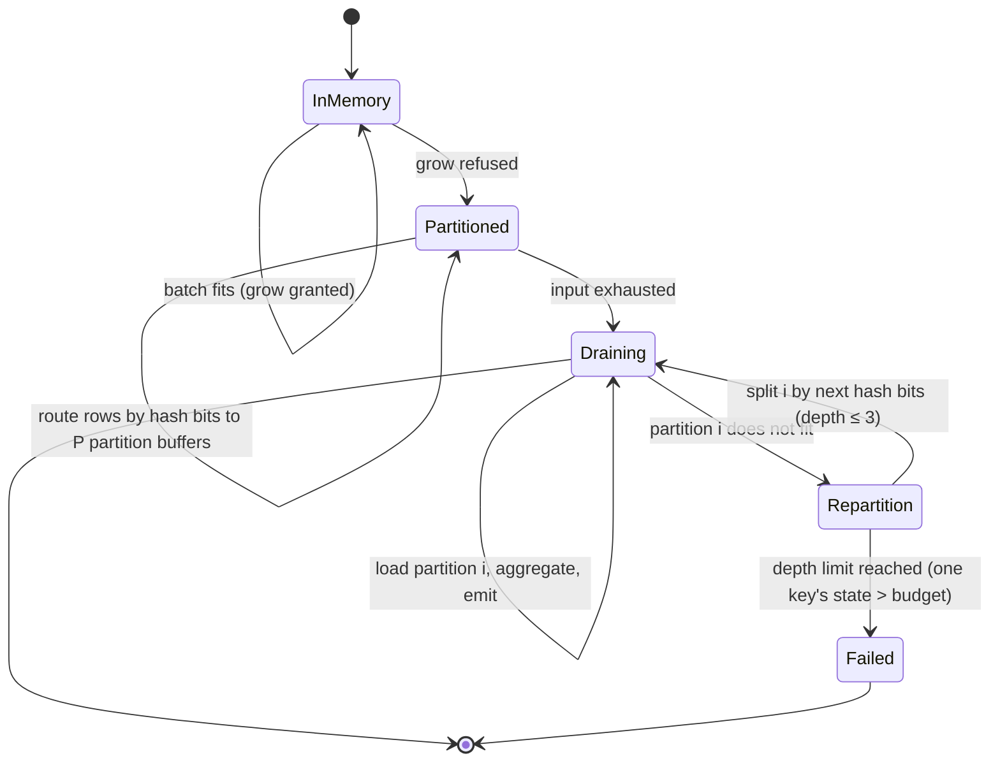

# Memory model

2026-11-02 · Companion to [production-readiness.md](production-readiness.md) §5-6 · Status: **design, not built** (except stream input buffering)

How SenkoParse keeps the promise "bounded memory": what memory means, who is allowed to hold it, what happens when the budget runs out, and how the claim is measured. The current code bounds only stream input ([architecture.md](architecture.md#stream-mode-bounded-blocks), [EXP-005-stream](experiments/005-stream-memory.md)); everything else here is the Phase 2 design.

**Contents:** [What memory means](#what-memory-means) · [Today](#today) · [The budget](#the-budget) · [Accounting rules](#accounting-rules) · [Operators](#operators) · [Hash aggregation](#hash-aggregation) · [Hash join](#hash-join) · [Sort](#sort-and-top-n) · [Spill and determinism](#spill-and-determinism) · [File-mode memory](#file-mode-memory) · [Failure behaviour](#failure-behaviour) · [Verification](#verification)

## What memory means

Three different numbers get called "memory", and a claim must say which one it means:

| Measure | What it counts | Who controls it | How we measure |
|---|---|---|---|
| **Accounted bytes** | bytes the engine has charged to its budget | the engine, exactly | `--stats` field `peak_accounted_bytes` |
| **Anonymous RSS** | resident heap and stack pages (not backed by a file) | the engine, approximately (allocator overhead, fragmentation) | Linux: `RssAnon` from `/proc/self/status` sampled, or `smaps_rollup`; macOS: `phys_footprint` from `task_info` |
| **Total RSS** | anonymous + file-backed resident pages (mapped input) | partly the OS | `ru_maxrss` via `bench/rss_wrap.py` (what EXP-005-stream reports) |

**Decision D-3 (recommended):** the budget limits accounted bytes; the published claim is about **total RSS** whenever `--memory-limit` is set, because that is what users and container limits see. To make that true, file mode under a limit stops mapping whole files ([File-mode memory](#file-mode-memory)). Every memory number we publish states which of the three it is.

The gap between accounted bytes and anonymous RSS is the **overhead**: binary and libraries, thread stacks, allocator slack, the output buffer, untracked small allocations. It is measured, not guessed, and published as a formula (target: ≤ 32 MiB + 2 MiB per thread).

## Today

| Component | Memory today | Bounded? |
|---|---|---|
| Stream input | queue of 16 pieces × ≤ 1 MiB + one block (4 MiB) + one partial row (≤ 64 MiB) | ✅ ~42 MiB total RSS measured on one query |
| File input | whole files memory-mapped | ❌ total RSS ≈ input size (5.4 GB at 1e8); anonymous memory small |
| Group tables | per-chunk partial tables, then merged; grows with chunks × groups | ❌ (Q4 at 1e8: 9.6 GB total RSS) |
| `COUNT(DISTINCT)` sets | per chunk, boxed keys | ❌ (Q5 at 3e7: ~1.5 GiB heap) |
| Join build side | whole build side in one table | ❌ |
| Sort | whole input to the sort | ❌ |
| Output | 64 KiB buffer, flushed per batch in stream mode | ✅ |

## The budget

One `MemoryBudget` per query, shared by every operator and thread.

```
MemoryBudget {
    limit: usize,              // from --memory-limit, default 50% of RAM capped by the cgroup limit
    reserved: AtomicUsize,     // bytes currently granted
    peak: AtomicUsize,
}
Grant  = budget.try_reserve(bytes) -> Option<Reservation>   // never blocks
Reservation::grow(bytes) -> bool                           // false = refused, caller must spill or shrink
Drop for Reservation releases its bytes
```

Rules:

1. **Reserve before allocating.** A table that wants to double its capacity reserves the new size first; if refused, it spills instead of growing.
2. **Grants are coarse.** Operators reserve in steps of at least 1 MiB (or 1/64 of their current size, whichever is larger), so the atomic counter is not touched per row.
3. **No operator may starve the others.** At start, each spillable operator gets a minimum guarantee (default 4 MiB per thread); the rest is first come, first served. With N threads × M operators exceeding the budget, the planner lowers the thread count and reports it (decision D-9).
4. **The budget is the only judge.** Nothing consults "free memory" at run time; results must not depend on what else is running on the machine.

Default limit: 50% of physical RAM, or of `/sys/fs/cgroup/memory.max` (Linux cgroup v2) when that is lower, so containers behave. `--memory-limit 0` means unlimited (today's behaviour, for benchmarks that compare with today).

## Accounting rules

What must be charged, so that the claim is honest:

| Charged | Not charged (counted in overhead) |
|---|---|
| hash table slots (capacity × slot size) | the binary, thread stacks |
| variable-length key bytes stored in tables | the 64 KiB output buffer |
| aggregate state heap (`state_bytes`), e.g. distinct sets, lists | per-batch scratch below 1 MiB per thread |
| sort buffers and run buffers | allocator metadata |
| stream queue and block buffers (today's bound, now explicit) | |
| file read buffers in budgeted file mode | |
| spill write and read buffers | |
| materialized batches held across operator boundaries (join build input, buffered stream for a second scan) | |

A test with a tracking global allocator (`#[global_allocator]` wrapper in a test binary only) checks that untracked allocation stays below a fixed bound while a query runs at a tiny limit. This turns "the memory bound is measured, not asserted" ([testing.md](testing.md#known-gaps)) into an assertion.

## Operators

| Operator | Class | Charged state | On refusal |
|---|---|---|---|
| Scan (stream) | constant | queue + block | never refused (reserved at start) |
| Scan (file, budgeted) | constant | 2 read buffers per worker | never refused (reserved at start) |
| Filter, Project, Probe, Limit | constant | — | — |
| Hash aggregation | state | table + key bytes + states | spill: grace partitioning |
| DISTINCT | state | as aggregation | as aggregation |
| Hash join build | state | table + build rows | spill: partition both sides |
| Sort | state | row buffer | spill: write a sorted run |
| Top-N | constant | heap of n rows | refuse only if n rows alone exceed the budget (error) |
| Buffered stream (second scan) | state | buffer | spill: append to a temp file |

## Hash aggregation



1. **In memory.** As today: per-chunk partial tables, or the partition-wise merge for many integer keys, with the strategy chosen from the measured reduction ratio ([performance-bets.md](performance-bets.md) I-3).
2. **Switch to partitioned.** On the first refused grow, choose fan-out P from the bytes seen so far and the remaining input estimate (file mode knows the size; stream mode assumes the worst and uses P = 64). Flush the current partial tables into the P partitions as serialized states, tagged with their chunk index.
3. **Route.** Every further row goes to its partition buffer by the top bits of its key hash. Partition buffers are memory buffers while the budget allows and spill to temp files when it does not: this is the shared radix partitioner, with two backends.
4. **Drain.** Partitions are processed one at a time, in partition index order. Within a partition, order-sensitive states are merged in chunk-index order (see below).
5. **Repartition** a partition that does not fit, with the next hash bits. A partition that still does not fit after depth 3 holds a few huge groups (for example a `STRING_AGG` over one key with gigabytes of text) and cannot be split by key: fail with `E-RESOURCE`.

`COUNT(DISTINCT x)` with spilling: the partition key is `(group, x)`, so distinct counting becomes a dedup on `(group, x)` followed by a count per group, both of which partition naturally.

## Hash join

1. Estimate both sides; pick the smaller as build side (today's rule). A stream is always the probe side (today's rule); a stream as build side (SRC-10) requires buffering it first.
2. Build in memory while grants succeed. On refusal, switch to a grace join: partition the build side by key hash into P files, then partition the probe side the same way as it streams, then join partition pairs one at a time. Probe rows of a partition whose build side is still in memory are joined immediately (hybrid hash join), so a build side slightly over the budget costs little.
3. Skew: a partition whose build side does not fit after repartitioning has one heavy key. For INNER and LEFT joins, the heavy key's build rows are streamed against its probe rows in blocks (block nested loop for that key only).
4. LEFT join: unmatched probe rows are emitted per partition, so correctness does not depend on the whole build side being in memory.

## Sort and top-N

- `ORDER BY ... LIMIT n` with n × row size within the budget uses a bounded heap: constant memory regardless of input.
- Full sort: fill a buffer up to the grant, sort it (stable), write it as a run; at the end, merge runs k-way with one read buffer per run. If the run count exceeds what the budget allows for read buffers, merge in passes.
- Stability across runs: each row carries its global sequence number (chunk index, row in chunk) as the final sort key, so ties keep file order exactly as the in-memory stable sort does, and output stays thread-independent.

## Spill and determinism

The hardest requirement: spilling must not change results, including the last bits of `f64` sums, and including the order of unordered results where today's tests expect a specific order.

| Concern | Rule |
|---|---|
| `f64` sums (order-sensitive states) | every serialized partial state carries its chunk index; within a partition, states and raw rows are folded in chunk-index order, then row order, which is exactly the order of the in-memory fixed tree for that group |
| Exact states (ADR-0004) | may be merged in any order |
| Unordered output order | spilled output is emitted in partition order; the in-memory partition-wise merge already emits in partition order, so both paths use the same partitioning function and fan-out rule to give the same order. Where they cannot (tree merge vs spill), tests compare unordered results as multisets, as today |
| Sort ties | sequence number as the final key (above) |
| Hash function | the same seed in memory and on disk; see decision D-2 for flooding |

**Spill file format (decision D-4, recommended).** A temp directory created with `mkdtemp` (0700), one file per partition opened with `O_EXCL` (0600). Each file is a sequence of blocks: `[u32 length][u32 crc32][payload]`. Payload rows are `[chunk: u32][row: u32][key bytes, length-prefixed][state or column values]`. Blocks are 1 MiB, so writes are sequential and reads need one buffer. The format is internal and versioned; it never outlives the process.

**Cleanup.** The directory is removed on success, error, panic hook, SIGINT and SIGTERM. On startup, stale `qe-spill-*` directories older than 24 hours owned by the user are reported (not deleted silently).

## File-mode memory

Today file mode maps each input file whole. That is fast, and the pages are page cache that the OS can drop, but they appear in total RSS, so a 5.55 GB input shows about 5.4 GB RSS. Two options, compared in [performance-bets.md](performance-bets.md) I-8:

| Option | How | Pros | Cons |
|---|---|---|---|
| A. `pread` into reused buffers | each worker reads its chunk into one of two 16 MiB buffers (double buffering) | RSS bounded by threads × 32 MiB; no `SIGBUS` on truncation; same code shape as stream blocks | one copy per byte (cheap next to parsing); strings must point into a live buffer |
| B. mmap + `madvise(MADV_DONTNEED)` behind the scan | release mapped pages after a chunk is parsed | zero copy | platform-specific; pages still counted until released; truncation still raises `SIGBUS` |

Recommended: **A when `--memory-limit` is set**, mmap otherwise, unless the experiment shows A within 10% on Q1 and Q6, in which case A becomes the only path and mmap is removed (one fewer `SIGBUS` hazard and one fewer `unsafe`).

## Failure behaviour

| Situation | Behaviour | Exit |
|---|---|---|
| Spill needed, no `--temp-dir` writable | `E-RESOURCE: memory limit 256 MiB reached and the temp directory /tmp is not writable; pass --temp-dir or raise --memory-limit` | 3 |
| Disk full while spilling | `E-RESOURCE: disk full while spilling to DIR after N bytes` | 3 |
| One group's state exceeds the budget | `E-RESOURCE: a single group needs more than the 256 MiB memory limit (group key: ...); raise --memory-limit` | 3 |
| Top-N with n rows over the budget | `E-RESOURCE` with the row count | 3 |
| Cancelled (SIGINT) | temp files removed, partial output flushed only if already written | 130 |

The process never relies on the OS killing it: with a limit set, RSS stays within limit + overhead, and an allocation failure in the global allocator is reported as `E-RESOURCE` rather than an abort, where Rust allows it (`try_reserve` on the big tables).

## Verification

| Test | Method | Pass |
|---|---|---|
| Spill identity | every operator at limits 1, 4, 16, 64, 256 MiB vs unlimited, on the difftest data and on 1e7-row data | identical output (bytes for ordered queries, multisets otherwise) |
| Spill determinism | spilled queries at 1, 2, 4, 11 threads | bit-identical, including `f64` |
| Accounting coverage | tracking allocator in a test binary | untracked bytes ≤ 8 MiB during the query |
| Memory suite M1-M6 | [benchmark-protocol.md](benchmark-protocol.md#suites) at 10x under `--memory-limit 256MB`, total RSS via `bench/rss_wrap.py`, anonymous RSS sampled | total RSS ≤ 256 MiB + overhead formula |
| Flat-memory claim | stream queries at 1x, 2x, 5x, 10x | peak RSS growth ≤ 25% (EXP-005-stream's kill rule) |
| Cleanup | SIGINT and SIGTERM at random points during spilling, 100 trials | no files left in the temp directory |
| Disk full | spill to a size-limited tmpfs (Linux) | `E-RESOURCE`, exit 3, no partial output claimed as complete |
