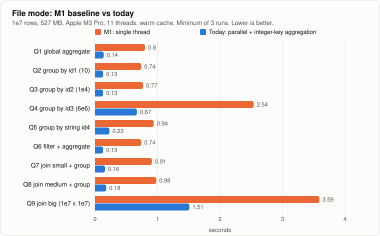
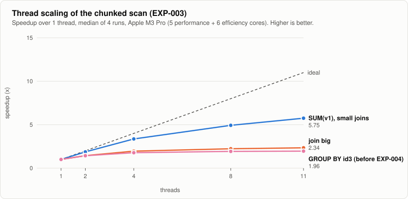
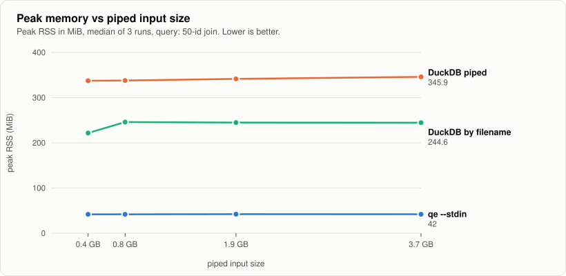

# Performance

What makes `qe` fast (file mode) and small (stream mode), **why each number is what it is**, what each technique bought, and what was measured and **not** worth keeping.
Every number links to an experiment or a table with the raw runs. Rule from [CLAUDE.md](../CLAUDE.md): *no number, no claim.*

**How to read the evidence tags.** Each cause below is tagged by how it was established:

| Tag | Meaning |
|---|---|
| **M** | Measured in isolation: one change, before/after (or an ablation that removes the suspected part), same machine |
| **P** | Attributed by a sampling profile (proportions, not exact) |
| **J** | Measured, but several changes shipped together, so their shares are **not** separated |
| **I** | Inferred from the design or from other numbers; **not** isolated. Treat as a hypothesis |

**Contents:** [Where we are](#where-we-are) · [Why the numbers are what they are](#why-the-numbers-are-what-they-are) · [Technique catalog](#technique-catalog) · [Streaming memory](#streaming-memory) · [What did not work](#what-did-not-work-or-is-not-yet-worth-it) · [Not yet isolated](#not-yet-isolated) · [Tuning knobs](#tuning-knobs) · [How to measure](#how-to-measure)

## Where we are

### Against DuckDB at 1e8 rows (current)

Apple M3 Pro, 11 cores, 18 GiB, swap 0, warm cache, 1e8 rows (5.55 GB per table; Q9 reads 11.1 GB), DuckDB 2.0.0, 3 runs, whole-process wall time (min). Source: [BENCHMARKS.md, "Interim, after EXP-008"](../BENCHMARKS.md). This is an interim run: cold cache and the final run are still to do, and claims C12/C13 are not updated from it.

| Query | qe | DuckDB | qe / DuckDB | Reading |
|---|---|---|---|---|
| Q1 global aggregate | 1.30 s | 1.44 s | 0.90x | tie (see note) |
| Q2 group by `id1` | 1.21 s | 1.62 s | 0.75x | qe faster |
| Q3 group by `id2` | 1.82 s | 2.00 s | 0.91x | tie |
| Q4 group by `id3` (6.3e7 groups) | 13.18 s | 3.26 s | 4.04x | qe 4x slower |
| Q5 group by `id4` + `COUNT(DISTINCT id2)` | 8.64 s | 2.76 s | 3.13x | qe 3x slower |
| Q6 filter + aggregate | 1.20 s | 1.54 s | 0.78x | qe faster |
| Q7 join small + group | 1.50 s | 1.66 s | 0.90x | tie |
| Q8 join medium + group | 3.40 s | 2.49 s | 1.37x | qe slower |
| Q9 join big (1e8 x 1e8) | 14.55 s | 4.94 s | 2.95x | qe 3x slower |

Note on "tie": DuckDB's wall time includes Python start-up and `import duckdb`. In the earlier 1e8 run the gap between its wall time and its in-process time was 0.15 to 0.19 s per query (for example Q1: 1.48 s wall, 1.32 s in process). Subtracting that, Q1, Q3 and Q7 are ties; Q2 (about 0.84x) and Q6 (about 0.88x) are the only clear qe wins. The correct summary is "ties or beats DuckDB on the scan-bound queries, 1.4x to 4x slower on high-cardinality GROUP BY, `COUNT(DISTINCT)` and large joins".

### History on 1e7 rows (M1 to M2 and EXP-004)



Machine: Apple M3 Pro, warm page cache, 1e7 rows (527 MB per table). Source: [BENCHMARKS.md](../BENCHMARKS.md). "Today" here means after M2 and EXP-004, **before** the integer-keyed join of EXP-008 (Q9 is 1.51 s in this table; it was 1.47 s at 3e7 after EXP-008, so these two Q9 numbers are different sizes and different code).

| Query | M1 (1 thread) | M2 + EXP-004 (11 threads) | Speedup | GB/s |
|---|---|---|---|---|
| Q1 global aggregate | 0.80 s | 0.14 s | 5.7x | 3.84 |
| Q2 group by `id1` (10 groups) | 0.74 s | 0.13 s | 5.7x | 4.04 |
| Q3 group by `id2` (1e4 groups) | 0.77 s | 0.13 s | 5.9x | 3.95 |
| Q4 group by `id3` (6.3e6 groups) | 2.54 s | 0.67 s | 3.8x | 0.78 |
| Q5 group by string `id4` | 0.94 s | 0.23 s | 4.1x | 2.30 |
| Q6 filter + aggregate | 0.74 s | 0.13 s | 5.7x | 3.95 |
| Q7 join small + group | 0.91 s | 0.16 s | 5.7x | 3.30 |
| Q8 join medium + group | 0.98 s | 0.18 s | 5.4x | 2.88 |
| Q9 join big (1e7 x 1e7) | 3.59 s | 1.51 s | 2.4x | 0.70 |

## Why the numbers are what they are

This section pins each number to its cause. Where a cause was not isolated it says so.

### 1. Scan-bound queries (Q1, Q2, Q3, Q6, Q7): about 4 GB/s

| Question | Answer | Tag | Evidence |
|---|---|---|---|
| Where did the single-thread time go before any tuning? | Finding field and row boundaries, not parsing: `COUNT(*)` (parses nothing) took 0.55 s, which is 75% of `SUM(v1)` (0.74 s). Float parsing was about 30% of a four-column scan profile (`from_utf8` + `f64::from_str`). | M, P | [EXP-001](experiments/001-baseline-breakdown.md) |
| Why is a scan-bound query now about 5.7x faster than M1? | **Parallel chunking**, not the quote-free fast path. `SUM(v1)`: 0.730 s on 1 thread, 0.127 s on 11 threads (5.7x). | M | [EXP-003](experiments/003-parallel-chunked-scan.md) |
| Did the quote-free fast path contribute to Q1, Q2, Q6? | **No.** They read `v1`, the last column, and the fast path gives 1.0x when the last column is read (`SUM(v1)` 0.739 s to 0.722 s). It helps only early-column queries (`COUNT(*)` 2.5x, `SUM(id1)` 2.1x). | M | [EXP-002](experiments/002-quote-free-fast-path.md) |
| Why does qe's all-core speed match DuckDB's? | Both are limited by parsing the same bytes. Per core, qe is close to DuckDB (1 thread, qe / DuckDB: Q1 1.15x, Q2 0.88x, Q3 1.04x, Q6 0.89x, Q7 1.09x). The all-core edge comes from **better scaling from 1 to 11 threads**, see the table below. | M (the ratios), I (the reason for the scaling) | BENCHMARKS.md interim tables |
| Why does qe scale better on these queries? | Each chunk runs a complete pipeline with no shared mutable state, and the merge is small (few groups). This is the design, but the scaling difference was **not isolated** against DuckDB's internals. | I | [EXP-003](experiments/003-parallel-chunked-scan.md) |
| Is it memory bandwidth? | At 1 thread qe reads 0.73 GB/s, far below the 13 GB/s memory-copy floor (`cat` of a warm 527 MB file: 0.04 s), so at 1 thread it is CPU-bound on parsing. The limit at 8 to 11 threads (+13% only, 5 performance + 6 efficiency cores) was **not** isolated. | M (floor, 1 thread), I (11 threads) | [EXP-001](experiments/001-baseline-breakdown.md), [EXP-003](experiments/003-parallel-chunked-scan.md) |
| What does determinism cost? | A few percent: chunk size and merge shape depend only on the file, never on the core count. | I (cost not isolated) | `tests/parallel.rs` |

**Speedup from 1 thread to 11 threads at 1e8 (M3 Pro, from the interim tables).** This is the clearest single view of where qe's engineering works and where it does not. DuckDB's wall times include about 0.15 s of Python start-up, which slightly understates its all-core speedup on the short queries.

| Query | qe 1 thread | qe 11 threads | qe speedup | DuckDB speedup |
|---|---|---|---|---|
| Q1 | 9.10 s | 1.30 s | 7.0x | 5.5x |
| Q2 | 7.95 s | 1.21 s | 6.6x | 5.6x |
| Q3 | 10.35 s | 1.82 s | 5.7x | 5.0x |
| Q6 | 7.71 s | 1.20 s | 6.4x | 5.6x |
| Q7 | 10.03 s | 1.50 s | 6.7x | 5.6x |
| Q8 | 16.21 s | 3.40 s | 4.8x | 4.8x |
| Q5 | 28.62 s | 8.64 s | 3.3x | 5.3x |
| Q9 | 40.33 s | 14.55 s | 2.8x | 5.0x |
| Q4 | 25.90 s | 13.18 s | **2.0x** | 6.4x |

Reading: on the scan-bound queries qe uses the cores as well as or better than DuckDB. On Q4, Q5 and Q9 it does not, and that, not the per-core cost, is the larger share of the gap (Q4 is 1.24x slower on one thread but 4.0x slower on all cores).

### 2. Joins (Q7, Q8, Q9)

| Question | Answer | Tag | Evidence |
|---|---|---|---|
| Why was Q9 slow before EXP-008? | The build side was a single-threaded `FxMap<Box<[u8]>, u32>`: one heap allocation per build row, a pointer chase and a `memcmp` on every probe. Profile at 3e7 on the container: `probe_batch` 19.9%, `build_table` 18.0%, `memcmp` 15.3%, kernel page zeroing 9.8%, glibc allocator and rehash about 9%. | P | [EXP-006](experiments/006-scaling-diagnosis.md) |
| Why did Q9 get faster? | An open-addressing table keyed directly on `i64` with the key stored inline (no per-key allocation, no `memcmp`), built in parallel from 64 hash partitions. Q9: 8.7x at 5e7 on the container (78.8 s to 9.04 s), **4.0x at 3e7 on the M3 Pro** (5.89 s to 1.47 s). | M for the whole change, **J** for the split | [EXP-008](experiments/008-int-join.md), [EXP-008b](experiments/008b-int-join-mac.md) |
| How much is the inline key and how much is the parallel build? | **Not separated.** Both shipped in one commit (`bff545a`). | J | [EXP-008](experiments/008-int-join.md) |
| Why is the Mac gain smaller than the container's? | The old byte-key join was already 6.3x faster on the M3 Pro (5.9 s vs 37 s at 3e7), so less was left to remove. Plausibly the M3 Pro's memory system and allocator hide more of the old cost. | I | [EXP-008b](experiments/008b-int-join-mac.md) |
| Why did Q7 and Q8 get 7 to 20% faster? | Probably a cheaper probe (one integer hash and an inline key compare instead of encoding 9 bytes and hashing them). Not profiled. | I | [EXP-008](experiments/008-int-join.md) |
| Why did 1e8 Q9 go from 85.4 s to 14.55 s? | Two causes mixed in one number: the code change, and a cleaner machine (the earlier run had 1.3 GiB of swap in use; this one had none). The code-only effect is the 4.0x at 3e7. | J | BENCHMARKS.md interim section |
| Why is Q9 still 3x behind DuckDB? | Not profiled after the change. It also still grows faster than linearly (1.47 s at 3e7, 14.55 s at 1e8: 9.9x for 3.3x the data). The likeliest cause is cache misses on a 1e8-entry table, but this is a **hypothesis**. | I | [EXP-008](experiments/008-int-join.md) ("Next") |

### 3. High-cardinality GROUP BY (Q4: 6.3e6 groups at 1e7, 6.3e7 at 1e8)

| Question | Answer | Tag | Evidence |
|---|---|---|---|
| Why was Q4 slow in M2? | One group table per chunk holding about 10M entries in total, then a re-hash and sort in the merge: 4.5 s on 1 thread, slower than M1 (2.5 s). About a third of M1's samples were table growth and per-group state initialisation. | M, P | [EXP-001](experiments/001-baseline-breakdown.md), [EXP-003](experiments/003-parallel-chunked-scan.md) |
| What got Q4 from 2.31 s to 0.67 s at 1e7? | Three changes, each measured: inline integer keys 2.28 to 1.65 s; allocation-free output 1.64 to 1.29 s; partition-wise parallel merge 1.29 to 0.67 s. The phase timers showed the build was cheap (0.18 s) and only the merge was serial (0.78 s). | M (each step) | [EXP-004](experiments/004-integer-key-aggregation.md) |
| Why is Q4 still 4.0x behind DuckDB at 1e8? | Per core the gap is small (1 thread: 25.9 s vs 20.8 s, 1.24x), but qe speeds up only 2.0x on 11 cores against DuckDB's 6.4x. With 6.3e7 groups from 1e8 rows nearly every key is distinct, so per-chunk tables do not reduce the data and the merge handles about as many entries as there were rows. This explanation is **inferred**; Q4 was not profiled at 1e8. | I | BENCHMARKS.md interim tables |
| Would reusing one table per worker help? | Yes on the container: Q4 18 to 31% faster at 1e7 to 5e7 (EXP-007's unplanned finding, measured, not yet confirmed on the M3 Pro). The change was reverted because it missed its Q3 bar. | M (container) | [EXP-007](experiments/007-table-reuse.md) |

### 4. Q3 and the effect of machine state

| Question | Answer | Tag | Evidence |
|---|---|---|---|
| Why did Q3 fall from 5.82 s to 1.82 s between the two 1e8 runs with no aggregation change? | The earlier run had 1.3 GiB of swap in use and the later one had none. The aggregation code for Q1 to Q6 did not change between them. So the earlier "3x loss" on Q3 was mostly machine state. | M (by comparison of the two runs) | [BENCHMARKS.md](../BENCHMARKS.md) |
| Is there a real per-chunk allocation cost for Q3? | On the 4-core Linux container yes: larger chunks cut Q3 by 24%, system CPU from 3.2 s to 0.3 s and RSS by 740 MiB, matching page zeroing of one table per chunk. On the M3 Pro, Q3 scales almost linearly (0.44 s at 3e7, 0.80 s at 5e7), so this cost is not visible there. | M (container), M (M3 Pro scaling) | [EXP-006](experiments/006-scaling-diagnosis.md), [EXP-009](experiments/009-distinct-per-thread.md) |

Lesson recorded here: **a number measured while the machine is swapping is not a measurement of the engine.** Check `sysctl vm.swapusage` before a run.

### 5. `COUNT(DISTINCT)` (Q5)

| Question | Answer | Tag | Evidence |
|---|---|---|---|
| What makes Q5 slow? | The per-chunk `COUNT(DISTINCT id2)` sets. Ablation at 3e7: with the DISTINCT 1.44 s, without it 0.42 s (71% of the wall time) and 1,455 MiB less peak RSS. | M | [EXP-009 step 1](experiments/009-q5-profile.md) |
| Where does the memory go? | One set per group per chunk: 98 chunks x 30 groups, about 25 million boxed keys live at once, which is about 95% of the 1.5 GiB heap. The rest of the 3.07 GiB peak is the mapped input. | P, M | [EXP-009 step 1](experiments/009-q5-profile.md) |
| Where does the time go? | Set insert 19.9%, `memcmp` 16.0%, set rehash 14.6% of samples; the pairwise merge of the sets (46% of samples) takes **longer than the scan**, and its upper tree levels have few pairs for 11 cores. | P | [EXP-009 step 1](experiments/009-q5-profile.md) |
| Does one set per worker thread fix it? | Partly: Q5 at 5e7 is 1.47x faster (min), 1.38x (median), RSS down 33%. That missed the 1.5x bar and the patch was reverted. The remaining cost is probably how the set is built (one heap allocation and a byte compare per new value), which is **not** confirmed. | M, I | [EXP-009](experiments/009-distinct-per-thread.md) |
| Why is Q5 3.1x behind DuckDB? | Per core 1.94x (28.6 s vs 14.7 s) and 3.3x scaling against 5.3x. The reasons above explain the direction; the split between them was not measured. | I | BENCHMARKS.md interim tables |

### 6. Streaming (`--stdin`)

| Question | Answer | Tag | Evidence |
|---|---|---|---|
| Why is qe's memory flat at 42 to 48 MiB? | A reader thread fills a bounded queue (16 x 1 MiB pieces); each block is cut after the last newline outside quotes and parsed by the normal parser; the partial row carries over. Nothing grows with input size for this query. | M (RSS from 375 MB to 3.7 GB), I (mechanism by design) | [EXP-005-stream](experiments/005-stream-memory.md) |
| Why does DuckDB 2.0.0 use 340 MiB and temp files on a pipe? | It reads piped input by buffering and spilling to temp files (as reported in DuckDB issue #25165). We reproduced it: temp use grows from 235 MiB to 5.2 GiB on the M3 Pro (237 MiB to 5.4 GiB on the container) as input grows from 375 MB to 3.7 GB; by filename it writes none. | M | [EXP-005-stream](experiments/005-stream-memory.md) |
| Why is qe faster than DuckDB piped? | The 3.4x to 6.0x on the M3 Pro (14.6x on the Linux container) is consistent with DuckDB's temp-file I/O, which would also explain why the gap is larger on the container. That is **inferred**; the I/O share was not isolated. | I | [BENCHMARKS.md](../BENCHMARKS.md) |
| Is qe faster than DuckDB reading the same file by name? | Only slightly: 2.50 s vs 2.96 s at 3.7 GB on the M3 Pro (about 1.2x), one thread each. The streaming advantage is **memory and temp use**, not raw speed. | M | [BENCHMARKS.md](../BENCHMARKS.md) |

Scope: one query (a join to a 50-id table), one reconstructed data shape. The stream query is the same shape as Q7, which is also where qe ties DuckDB in file mode.

### 7. Things that were assumed to help but did not (or do not apply)

| Assumption | What the numbers say | Tag |
|---|---|---|
| "The quote-free fast path explains our scan speed" | No: it gives 1.0x on queries that read the last column, which is all of Q1, Q2 and Q6 | M |
| "Bigger chunks fix the per-chunk table cost" | 24% on Q3 on the container, but Q2 got 15% slower and 1e7 got slower (only 2 chunks for 4 cores); not a fix | M |
| "Per-thread distinct sets halve Q5's memory" | RSS fell 33%, not 50%; the mapped input alone is too large for 50% | M |
| "The 14.6x streaming ratio is general" | It was specific to the Linux container; the M3 Pro gives 6.0x at the same size | M |
| "Q3 is slow at 1e8" | It was slow only while the machine was swapping | M |

## Technique catalog

Each technique is written as: **idea → mechanism → where → effect → evidence**.

### 1. Skip fields nobody reads (quote-free fast path)

- **Idea.** Boundary discovery, not parsing, dominates simple queries: walking 70M fields costs about 0.55 of 0.8 s ([EXP-001](experiments/001-baseline-breakdown.md)).
- **Mechanism.** If a chunk contains no `"` byte (one SIMD `memchr`), rows are `\n`-delimited and fields `,`-delimited. Stop splitting after the last needed column and jump to the next newline. Count commas per line so ragged rows still error identically.
- **Where.** `storage/csv/mod.rs` (`next_batch_quote_free`).
- **Effect.** `COUNT(*)` 0.566 → 0.223 s (2.5x); `SUM(id1)` 0.626 → 0.295 s (2.1x). **No gain** when the last column is read (`SUM(v1)` 1.0x): the remaining cost is one `memchr(',')` per field.
- **Evidence.** [EXP-002](experiments/002-quote-free-fast-path.md). The gate (`SUM(id1)` < 0.3 s) was met barely.

### 2. Exact parallel chunking

- **Idea.** Split the file into row-aligned chunks without ever splitting a quoted field.
- **Mechanism.** Count quote bytes per raw range in parallel, prefix-XOR the parities, then scan forward to the first newline outside quotes. Exact because every quote is structural (stray quotes are errors).
- **Where.** `CsvSource::plan_chunks`, `exec/par.rs`.
- **Effect.** 5.1–5.9x from 1 to 11 threads on scan-bound queries.
- **Evidence.** [EXP-003](experiments/003-parallel-chunked-scan.md).



Scan-bound queries reach about 5.8x on 11 threads (the machine has 5 performance and 6 efficiency cores, so 11 threads is not 11x; going from 8 to 11 threads adds only about 13%). Whether memory bandwidth or core heterogeneity is the limit was **not isolated**.

### 3. Fixed chunks, fixed merge order (determinism for free)

- **Idea.** Make chunking depend on the file and `chunk_bytes`, never on the core count.
- **Mechanism.** Merge per-chunk partials in a fixed-shape tree; emit batches in chunk order.
- **Effect.** Byte-identical output at 1, 2, 3, 5, 8, 11 threads, including `f64` sums. Costs a few percent.
- **Evidence.** `tests/parallel.rs::float_results_do_not_depend_on_thread_count`.

### 4. Inline integer keys (no per-row allocation)

- **Idea.** A group key stored as a heap-allocated `Box<[u8]>` costs an allocation per group and wrecks the cache.
- **Mechanism.** For a single `i64`, decimal or date key, store `u32` slots plus one `i64` per group; merge in group order without sorting.
- **Effect (before → after, 11 threads).** `GROUP BY id3`: 2.28 → 1.65 s. Low-cardinality queries gain 7–12%. The string-key control was unchanged, as predicted.
- **Evidence.** [EXP-004 part A](experiments/004-integer-key-aggregation.md). The prediction (< 1.5 s) **missed**; the kill threshold (25% faster) was cleared (−27.6%).

### 5. Allocation-free output

- **Idea.** Writing 6.3M result rows cost 0.64 s, mostly `format!`/`to_string` per cell.
- **Mechanism.** Write integers and floats straight into the output buffer.
- **Effect.** `GROUP BY id3` 1.644 → 1.289 s (output share 0.64 → ~0.28 s).
- **Evidence.** EXP-004b. Float formatting itself (shortest round-trip) remains; a faster algorithm needs a dependency (not added).

### 6. Partition-wise parallel merge

- **Idea.** The phase timers showed the build was cheap (0.18 s) and **only the merge was serial** (0.78 s), so fix the measured cost instead of re-partitioning rows.
- **Mechanism.** Bucket each table's groups into 64 hash partitions; merge each partition on its own task, folding chunks in index order.
- **Used when** the per-chunk tables hold > 262,144 groups in total and the key is a single integer-like column.
- **Effect.** `GROUP BY id3` 1.29 → 0.67 s (Q4 above; 2.54 s in M1).
- **Trade-off, stated up front.** Group order in unordered results becomes partition order (still thread-independent).
- **Evidence.** [EXP-004 part B](experiments/004-integer-key-aggregation.md).

### 7. Bounded blocks for streams

- **Idea.** Do not spool the stream to disk (that is what makes DuckDB's temp use grow). Cut it into quote-correct blocks and parse each block with the existing parser.
- **Mechanism.** Reader thread + bounded queue; cut after the last newline outside quotes; carry the partial row. See [architecture](architecture.md#stream-mode-bounded-blocks).
- **Effect.** Peak RSS 42 MiB from 375 MB to 3.7 GB of input; no temp files.
- **Evidence.** [EXP-005-stream](experiments/005-stream-memory.md).

### 8. Integer-keyed, parallel-built join table

- **Idea.** A join on one integer-like key should not go through a generic byte-key map that allocates per row.
- **Mechanism.** When both sides have a single `i64`, decimal or date key, build an open-addressing table whose slots hold `(key: i64, head: u32)` inline (splitmix64 hash, load factor at most 0.6). The build is split into 64 hash partitions (1 for builds under 65,536 rows), each filled by one task in row order, so duplicate-key chains and output order do not depend on the thread count. Strings, floats and composite keys keep the byte-key join; `--no-opt` and stream-probe joins also keep it.
- **Where.** `exec/hash_join.rs` (`build_int_table`, `int_join_eligible`, `IntJoin`).
- **Effect.** Q9 8.7x at 5e7 on the container; 4.0x at 3e7 on the M3 Pro. Q7/Q8 7 to 20% faster. Peak RSS for Q9 6 to 7% lower.
- **Evidence.** [EXP-008](experiments/008-int-join.md), [EXP-008b](experiments/008b-int-join-mac.md). Tests: 1,230 engine runs against SQLite over 9 data variants, a thread-identity test, 4 mutation checks.

### Summary

| # | Technique | Targets | Measured effect | Status |
|---|---|---|---|---|
| 1 | Quote-free fast path | boundary discovery | 2.1–2.5x on early-column queries, 1.0x on late columns | kept |
| 2 | Exact parallel chunking | single-core ceiling | 5.1–5.9x on 11 threads | kept |
| 3 | Fixed chunks and merge order | determinism | byte-identical across thread counts | kept |
| 4 | Inline integer keys | per-group allocation | `GROUP BY id3` 2.28 → 1.65 s | kept |
| 5 | Allocation-free output | per-cell allocation | 1.64 → 1.29 s | kept |
| 6 | Partition-wise merge | serial merge tail | 1.29 → 0.67 s | kept |
| 7 | Bounded stream blocks | input buffering | RSS flat at 42 MiB | kept |
| 8 | Integer-keyed parallel join | per-row allocation, serial build | Q9 4.0x (M3 Pro 3e7), 8.7x (container 5e7) | kept |
| – | Per-worker table reuse (EXP-007) | per-chunk table allocation | Q4 −18 to −31% (container), Q3 only −11% | **reverted**, patch kept |
| – | Per-thread DISTINCT sets (EXP-009) | per-chunk set memory | Q5 1.47x, RSS −33% (M3 Pro, 5e7) | **reverted**, patch kept |

## Streaming memory



| Size | Input | `qe` wall (min) | DuckDB file wall (min) | DuckDB piped wall (min) |
|---|---|---|---|---|
| 1x | 375 MB | 0.55 s | 0.90 s | 2.04 s |
| 2x | 750 MB | 1.03 s | 1.57 s | 4.23 s |
| 5x | 1.9 GB | 2.54 s | 3.55 s | 18.3 s |
| 10x | 3.7 GB | 4.78 s | 6.96 s | 69.8 s |

One query (a 50-id join), one reconstructed data shape, 4-core Xeon container, 1 thread each. These wall times describe this query only and are **not** a general speed claim. The 69.8 s is DuckDB 2.0.0 piped at 10x; the ratio to `qe` is 14.6x. An M3 Pro re-run with DuckDB 2.0.0 gave 6.0x at 10x (2.50 s vs 14.96 s), so the size of the gap is machine-dependent ([BENCHMARKS.md](../BENCHMARKS.md)). Full table with RSS and temp: [BENCHMARKS.md](../BENCHMARKS.md#piped-streaming-qe---stdin-vs-duckdb-200-exp-005-stream).

## What did not work, or is not yet worth it

Honest negatives are part of the record. Experiments that missed their kill rule were reverted; the patch is kept under `docs/experiments/data/`.

| Item | What happened |
|---|---|
| Per-chunk tables for millions of groups | **Slower than M1** at 1 thread (4.5 s vs 2.5 s): ~10M entries across chunks, then a re-hash and sort in the merge ([EXP-003](experiments/003-parallel-chunked-scan.md), hypothesis 3). Techniques 4–6 fixed this at 1e7, but Q4 still scales poorly on 11 cores at 1e8 (2.0x, against DuckDB's 6.4x) |
| EXP-004 part A prediction | Predicted < 2.5 s at 1 thread and < 1.5 s at 11 threads; got 3.1 s and 1.65 s. Kept because the kill threshold was cleared, and recorded as a miss |
| Fast path on the last column | No gain (1.0x). The cost is a `memchr` per skipped field. Follow-up idea (find all commas of a line in one vectorised pass) **not done** |
| 8 → 11 threads | +13% only; cause not isolated |
| Per-worker aggregation table reuse ([EXP-007](experiments/007-table-reuse.md)) | Missed the 15% Q3 bar (11 to 13% at 5e7 on the container) and was reverted, although Q4 gained 18 to 31%. Worth re-testing for Q4 on its own kill rule |
| Per-thread `COUNT(DISTINCT)` sets ([EXP-009](experiments/009-distinct-per-thread.md)) | Q5 1.47x (min) / 1.38x (median) at 5e7, below the 1.5x bar; RSS −33%. Reverted. Next idea: store the values inline as integers |
| Adaptive (bigger) chunk size | Dropped after [EXP-006](experiments/006-scaling-diagnosis.md): helps Q3 on the container but hurts Q2 and small inputs |
| SIMD bitmasks, GPU, `unsafe` micro-optimisations | Not attempted |
| Columnar cache (`--cache`) | Not implemented (helps repeat runs only; the cold path is the one that gets timed) |

## Not yet isolated

Things the numbers suggest but nobody has separated. Each is a candidate experiment, listed in the [roadmap](roadmap.md).

| Open question | Why it matters |
|---|---|
| Inline key vs parallel build in EXP-008 | Which part of the Q9 gain to extend (for example to the stream-probe join) |
| What still makes Q9 superlinear (1.47 s at 3e7, 14.55 s at 1e8) | The remaining 3x gap to DuckDB |
| Why qe scales 2.0x on Q4 and 3.3x on Q5 while DuckDB scales 6.4x and 5.3x | The largest remaining gaps; cause inferred, not profiled at 1e8 |
| Why qe scales better than DuckDB on the scan-bound queries | Whether the edge is design or just DuckDB's harness overhead |
| What limits 8 to 11 threads on the M3 Pro (+13%) | Memory bandwidth vs the mix of performance and efficiency cores |
| Cold-cache cost | Cold first runs were up to 2.7x slower than warm on the container; the M3 Pro cold numbers are still to do |
| Whether the container-measured gains carry over | EXP-007's Q4 gain and EXP-006's chunk finding are container results; only EXP-008 and EXP-009 were confirmed or measured on the M3 Pro |

## Tuning knobs

| Knob | Where | Default | Effect | Results depend on it? |
|---|---|---|---|---|
| `--threads N` | CLI, `Options::threads` | all cores | scan and aggregation parallelism (file mode) | never |
| `--chunk-bytes N` | CLI, `Options::chunk_bytes` | 16 MiB (file), 4 MiB (stream) | file: chunk size, i.e. parallel granularity and per-chunk table count. Stream: block target | never |
| `agg_partition_groups` | `Options` (tests) | 262,144 | switch point to the partitioned merge | never (group order only, unordered results) |
| `--no-opt` | CLI | off | single-threaded reference path | no |

Tiny `--chunk-bytes` values exist for the tests (they force splits inside quoted fields); they are slow on purpose.

## How to measure

```bash
cargo build --release
python3 scripts/gen_data.py --rows 1e7                           # db-benchmark-shaped data
python3 bench/run.py --rows 1e7                                  # nine queries, appends to BENCHMARKS.md
python3 bench/exp.py --runs 5 --extra="--threads 1" "SELECT ..." # every raw run, for experiment files
python3 bench/file_vs_duckdb.py check                            # qe vs DuckDB outputs must match before any timing
python3 bench/file_vs_duckdb.py time --settings warm-all         # 1e8 qe vs DuckDB, all cores (also: warm-1t, cold)
python3 bench/gen_stream_data.py --out D                         # stream data (reconstruction of issue #25165's shape)
python3 bench/exp005_stream.py --data D --work W --duckdb-python PY --runs 3
python3 bench/make_charts.py                                     # regenerate docs/img/*.svg
```

Rules: same machine, release build, warm page cache unless labelled; record every raw run; noisy numbers are reported as noisy; a correctness gate (`cargo test`, difftest) before any number counts; **check `sysctl vm.swapusage` (macOS) before timing and record it**, because a run that swaps measures the machine, not the engine; compare before and after as interleaved runs of two binaries; write the kill rule before the code.
