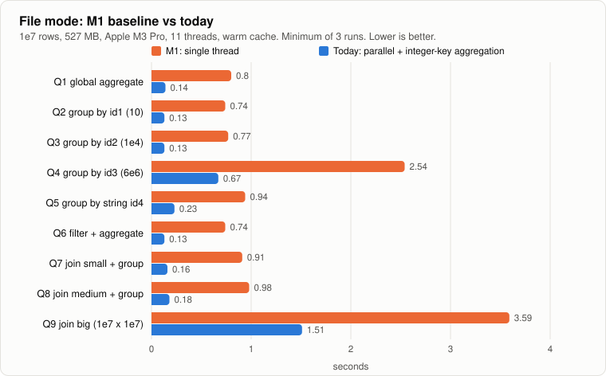
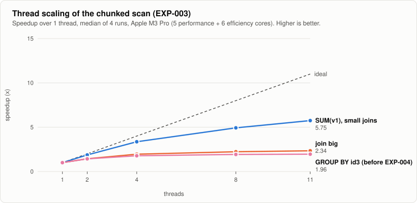
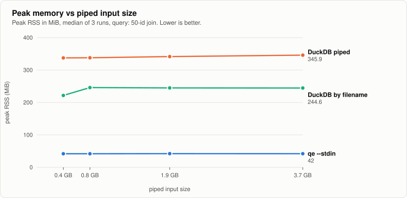

# Performance

What makes `qe` fast (file mode) and small (stream mode), what each technique bought, and what was measured and **not** worth keeping.
Every number links to an experiment with the raw runs. Rule from [CLAUDE.md](../CLAUDE.md): *no number, no claim.*

**Contents:** [Where we are](#where-we-are) · [Technique catalog](#technique-catalog) · [Streaming memory](#streaming-memory) · [What did not work](#what-did-not-work-or-is-not-yet-worth-it) · [Tuning knobs](#tuning-knobs) · [How to measure](#how-to-measure)

## Where we are



Machine for file-mode numbers: Apple M3 Pro, 11 cores (5 performance + 6 efficiency), 18 GiB, warm page cache, 1e7 rows (527 MB per table). Source: [BENCHMARKS.md](../BENCHMARKS.md).

| Query | M1 (1 thread) | Today (11 threads) | Speedup | GB/s today |
|---|---|---|---|---|
| Q1 global aggregate | 0.80 s | 0.14 s | 5.7x | 3.84 |
| Q2 group by `id1` (10 groups) | 0.74 s | 0.13 s | 5.7x | 4.04 |
| Q3 group by `id2` (1e4 groups) | 0.77 s | 0.13 s | 5.9x | 3.95 |
| Q4 group by `id3` (6.3e6 groups) | 2.54 s | 0.67 s | 3.8x | 0.78 |
| Q5 group by string `id4` | 0.94 s | 0.23 s | 4.1x | 2.30 |
| Q6 filter + aggregate | 0.74 s | 0.13 s | 5.7x | 3.95 |
| Q7 join small + group | 0.91 s | 0.16 s | 5.7x | 3.30 |
| Q8 join medium + group | 0.98 s | 0.18 s | 5.4x | 2.88 |
| Q9 join big (1e7 × 1e7) | 3.59 s | 1.51 s | 2.4x | 0.70 |

Not measured: cold cache, and any DuckDB comparison on file mode (the direction change in [ADR-0002](adr/0002-stream-first-direction.md) put memory on streams first).

## Technique catalog

Each technique is written as: **idea → mechanism → where → effect → evidence**.

### 1. Skip fields nobody reads (quote-free fast path)

- **Idea.** Boundary discovery, not parsing, dominates simple queries: walking 70M fields costs about 0.55 of 0.8 s ([EXP-001](experiments/001-baseline-breakdown.md)).
- **Mechanism.** If a chunk contains no `"` byte (one SIMD `memchr`), rows are `\n`-delimited and fields `,`-delimited. Stop splitting after the last needed column and jump to the next newline. Count commas per line so ragged rows still error identically.
- **Where.** `storage/csv/mod.rs` (`next_batch_quote_free`).
- **Effect.** `COUNT(*)` 0.566 → 0.223 s (2.5x); `SUM(id1)` 0.626 → 0.295 s (2.1x). **No gain** when the last column is read (`SUM(v1)` 1.0x): the remaining cost is one `memchr(',')` per field.
- **Evidence.** [EXP-002](experiments/002-quote-free-fast-path.md). The gate (`SUM(id1)` < 0.3 s) was met barely.

### 2. Exact parallel chunking

- **Idea.** Split the file into row-aligned chunks without ever splitting a quoted field.
- **Mechanism.** Count quote bytes per raw range in parallel, prefix-XOR the parities, then scan forward to the first newline outside quotes. Exact because every quote is structural (stray quotes are errors).
- **Where.** `CsvSource::plan_chunks`, `exec/par.rs`.
- **Effect.** 5.1–5.9x from 1 to 11 threads on scan-bound queries.
- **Evidence.** [EXP-003](experiments/003-parallel-chunked-scan.md).



Scan-bound queries reach about 5.8x on 11 threads (the machine has 5 performance and 6 efficiency cores, so 11 threads is not 11x; going from 8 to 11 threads adds only about 13%). Whether memory bandwidth or core heterogeneity is the limit was **not isolated**.

### 3. Fixed chunks, fixed merge order (determinism for free)

- **Idea.** Make chunking depend on the file and `chunk_bytes`, never on the core count.
- **Mechanism.** Merge per-chunk partials in a fixed-shape tree; emit batches in chunk order.
- **Effect.** Byte-identical output at 1, 2, 3, 5, 8, 11 threads, including `f64` sums. Costs a few percent.
- **Evidence.** `tests/parallel.rs::float_results_do_not_depend_on_thread_count`.

### 4. Inline integer keys (no per-row allocation)

- **Idea.** A group key stored as a heap-allocated `Box<[u8]>` costs an allocation per group and wrecks the cache.
- **Mechanism.** For a single `i64`, decimal or date key, store `u32` slots plus one `i64` per group; merge in group order without sorting.
- **Effect (before → after, 11 threads).** `GROUP BY id3`: 2.28 → 1.65 s. Low-cardinality queries gain 7–12%. The string-key control was unchanged, as predicted.
- **Evidence.** [EXP-004 part A](experiments/004-integer-key-aggregation.md). The prediction (< 1.5 s) **missed**; the kill threshold (25% faster) was cleared (−27.6%).

### 5. Allocation-free output

- **Idea.** Writing 6.3M result rows cost 0.64 s, mostly `format!`/`to_string` per cell.
- **Mechanism.** Write integers and floats straight into the output buffer.
- **Effect.** `GROUP BY id3` 1.644 → 1.289 s (output share 0.64 → ~0.28 s).
- **Evidence.** EXP-004b. Float formatting itself (shortest round-trip) remains; a faster algorithm needs a dependency (not added).

### 6. Partition-wise parallel merge

- **Idea.** The phase timers showed the build was cheap (0.18 s) and **only the merge was serial** (0.78 s), so fix the measured cost instead of re-partitioning rows.
- **Mechanism.** Bucket each table's groups into 64 hash partitions; merge each partition on its own task, folding chunks in index order.
- **Used when** the per-chunk tables hold > 262,144 groups in total and the key is a single integer-like column.
- **Effect.** `GROUP BY id3` 1.29 → 0.67 s (Q4 above; 2.54 s in M1).
- **Trade-off, stated up front.** Group order in unordered results becomes partition order (still thread-independent).
- **Evidence.** [EXP-004 part B](experiments/004-integer-key-aggregation.md).

### 7. Bounded blocks for streams

- **Idea.** Do not spool the stream to disk (that is what makes DuckDB's temp use grow). Cut it into quote-correct blocks and parse each block with the existing parser.
- **Mechanism.** Reader thread + bounded queue; cut after the last newline outside quotes; carry the partial row. See [architecture](architecture.md#stream-mode-bounded-blocks).
- **Effect.** Peak RSS 42 MiB from 375 MB to 3.7 GB of input; no temp files.
- **Evidence.** [EXP-005-stream](experiments/005-stream-memory.md).

### Summary

| # | Technique | Targets | Measured effect | Status |
|---|---|---|---|---|
| 1 | Quote-free fast path | boundary discovery | 2.1–2.5x on early-column queries, 1.0x on late columns | kept |
| 2 | Exact parallel chunking | single-core ceiling | 5.1–5.9x on 11 threads | kept |
| 3 | Fixed chunks and merge order | determinism | byte-identical across thread counts | kept |
| 4 | Inline integer keys | per-group allocation | `GROUP BY id3` 2.28 → 1.65 s | kept |
| 5 | Allocation-free output | per-cell allocation | 1.64 → 1.29 s | kept |
| 6 | Partition-wise merge | serial merge tail | 1.29 → 0.67 s | kept |
| 7 | Bounded stream blocks | input buffering | RSS flat at 42 MiB | kept |

## Streaming memory



| Size | Input | `qe` wall (min) | DuckDB file wall (min) | DuckDB piped wall (min) |
|---|---|---|---|---|
| 1x | 375 MB | 0.55 s | 0.90 s | 2.04 s |
| 2x | 750 MB | 1.03 s | 1.57 s | 4.23 s |
| 5x | 1.9 GB | 2.54 s | 3.55 s | 18.3 s |
| 10x | 3.7 GB | 4.78 s | 6.96 s | 69.8 s |

One query (a 50-id join), one reconstructed data shape, 4-core Xeon container, 1 thread each. These wall times describe this query only and are **not** a general speed claim. The 69.8 s is DuckDB 2.0.0 piped at 10x; the ratio to `qe` is 14.6x. An M3 Pro re-run with DuckDB 1.4.5 gave 4.2x (1x) and 3.9x (5x). Full table with RSS and temp: [BENCHMARKS.md](../BENCHMARKS.md#piped-streaming-qe---stdin-vs-duckdb-200-exp-005-stream).

## What did not work, or is not yet worth it

Honest negatives are part of the record.

| Item | What happened |
|---|---|
| Per-chunk tables for millions of groups | **Slower than M1** at 1 thread (4.5 s vs 2.5 s): ~10M entries across chunks, then a re-hash and sort in the merge ([EXP-003](experiments/003-parallel-chunked-scan.md), hypothesis 3). This is what techniques 4–6 fixed |
| EXP-004 part A prediction | Predicted < 2.5 s at 1 thread and < 1.5 s at 11 threads; got 3.1 s and 1.65 s. Kept because the kill threshold was cleared, and recorded as a miss |
| Fast path on the last column | No gain (1.0x). The cost is a `memchr` per skipped field. Follow-up idea (find all commas of a line in one vectorised pass) **not done** |
| 1e7 × 1e7 join | Only 2.4x: the build is serial (about 1.3 s of 1.5 s). Parallel build / dense-key array join is deferred ("Later" in [CLAUDE.md](../CLAUDE.md)) |
| 8 → 11 threads | +13% only; cause not isolated |
| SIMD bitmasks, GPU, `unsafe` micro-optimisations | Not attempted. Ranked after the items above in the plan |
| Columnar cache (`--cache`) | Not implemented |

## Tuning knobs

| Knob | Where | Default | Effect | Results depend on it? |
|---|---|---|---|---|
| `--threads N` | CLI, `Options::threads` | all cores | scan and aggregation parallelism (file mode) | never |
| `--chunk-bytes N` | CLI, `Options::chunk_bytes` | 16 MiB (file), 4 MiB (stream) | file: chunk size, i.e. parallel granularity and per-chunk table count. Stream: block target | never |
| `agg_partition_groups` | `Options` (tests) | 262,144 | switch point to the partitioned merge | never (group order only, unordered results) |
| `--no-opt` | CLI | off | single-threaded reference path | no |

Tiny `--chunk-bytes` values exist for the tests (they force splits inside quoted fields); they are slow on purpose.

## How to measure

```bash
cargo build --release
python3 scripts/gen_data.py --rows 1e7                           # db-benchmark-shaped data
python3 bench/run.py --rows 1e7                                  # nine queries, appends to BENCHMARKS.md
python3 bench/exp.py --runs 5 --extra="--threads 1" "SELECT ..." # every raw run, for experiment files
python3 bench/gen_stream_data.py --out D                         # stream data (reconstruction of issue #25165's shape)
python3 bench/exp005_stream.py --data D --work W --duckdb-python PY --runs 3
python3 bench/make_charts.py                                     # regenerate docs/img/*.svg
```

Rules: same machine, release build, warm page cache unless labelled; record every raw run; noisy numbers are reported as noisy; a correctness gate (`cargo test`, difftest) before any number counts.
