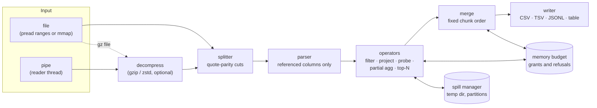
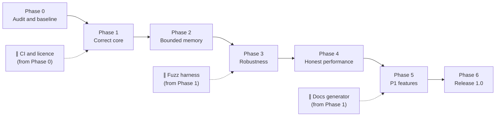

# SenkoParse (qe): Production-Readiness Plan

**Version 2** · 2026-11-02 · Owner: @Boss · Status: **Draft, for team review**
Audited against `main` at `f80c6e0` (2026-11-01). Supersedes the v1 plan of the same date.

This is the master plan for taking SenkoParse from a hackathon build to a tool other people can rely on. It says what "production-ready" means in numbers, what is true of the code today, what has to change, in which order, and how each step is proven. Details live in companion documents so that this page stays readable:

| Companion | What it holds | Owns |
|---|---|---|
| [sql-surface.md](sql-surface.md) | every SQL feature: state today, priority, acceptance test | the supported-SQL list (README is generated from it) |
| [semantics.md](semantics.md) | exact meaning of NULL, types, arithmetic, ordering, output | what a "correct answer" is |
| [memory-model.md](memory-model.md) | memory budget, accounting, spill, file-mode memory | the "bounded memory" claim |
| [correctness.md](correctness.md) | oracles, generator, fuzzing, deviations register | the "verified" claim |
| [benchmark-protocol.md](benchmark-protocol.md) | pre-registered suites, machines, thresholds, reporting | every speed claim |
| [cli.md](cli.md) | flags, exit codes, stdout/stderr contract, compatibility | the user-facing interface |
| [performance-bets.md](performance-bets.md) | counterintuitive moves for the losing queries, each with mechanism and kill rule | which performance experiments come next |
| [design-notes.md](design-notes.md) | ideas borrowed from other engines, with sources and licences | provenance |
| [pitch-qa.md](pitch-qa.md) | hostile-question answers, each tied to a phase gate | what we say out loud |

Existing pages keep their roles: [status.md](status.md) is the claims ledger, [testing.md](testing.md) documents the test suites, [architecture.md](architecture.md) describes the code as it is, [roadmap.md](roadmap.md) holds performance hypotheses, and [`BENCHMARKS.md`](../BENCHMARKS.md) holds every number.

**Contents:** [0 Changes from v1](#0-what-changed-from-v1) · [1 Vision](#1-vision-scope-and-non-goals) · [2 Audit](#2-where-we-are-today) · [3 Requirements](#3-requirements) · [4 SQL surface](#4-sql-surface) · [5 Aggregation](#5-aggregation-deep-dive) · [6 Architecture and memory](#6-architecture-and-memory-model) · [7 Correctness](#7-correctness-plan) · [8 Performance](#8-performance-plan) · [9 Robustness and security](#9-input-robustness-and-security) · [10 Operability](#10-operability-and-observability) · [11 Release engineering](#11-release-engineering) · [12 Phases](#12-phased-plan) · [13 Risks](#13-risk-register) · [14 Decisions](#14-open-decisions) · [15 Scorecard](#15-scorecard) · [Appendix](#appendix)

---

## 0. What changed from v1

v1 was written without access to the code ("I have not seen the current code"). v2 is grounded in a read of the repository, its tests and its experiment log. The material changes:

| # | v1 said | v2 says, and why |
|---|---|---|
| 1 | Stream memory numbers came from "EXP-009" | They come from **EXP-005-stream** (`docs/experiments/005-stream-memory.md`). EXP-009 is the per-worker `COUNT(DISTINCT)` experiment. All references corrected. |
| 2 | "Unit and difftests were not re-run" | EXP-005-stream records `cargo test` green. What was *not* re-run is the difftest under mutation M-2, and the large stream difftest for seeds 1001-1002 ([testing.md](testing.md#falsification-log)). |
| 3 | Compare every feature with DuckDB | The existing oracle is **SQLite** (`tests/difftest.rs`, 5 engine configurations). v2 keeps SQLite as the primary oracle and adds DuckDB as a second oracle for features SQLite lacks, with a normalisation layer ([correctness.md](correctness.md)). |
| 4 | Flags beyond `--data`, `--stdin`, `--threads` are proposed | The CLI already has `--no-opt`, `--chunk-bytes`, `--progress`, `--table`, `--file`, `--shell`, `--serve`, `--port`. v2 lists real versus proposed flags in [cli.md](cli.md). |
| 5 | "Filters and small joins run in constant memory" | True for **anonymous** memory in stream mode on one measured query. File mode memory-maps whole inputs, so its RSS is about the input size (5.4 GB RSS on a 5.55 GB file at 1e8). v2 defines memory precisely and plans for both modes ([memory-model.md](memory-model.md)). |
| 6 | Types include BOOL and TIMESTAMP, with type inference | Today: `i64`, `f64`, `decimal(N)`, `str`, `date`, declared in a **required** `schema.toml`. No inference, no timestamp, no boolean column type. Inference becomes P0 because a judge or user arriving with their own CSV cannot run anything today. |
| 7 | One flat feature table | Each feature now has an ID, a measured "today" state with evidence, and a named acceptance test ([sql-surface.md](sql-surface.md)). |
| 8 | No requirement IDs, risks or decisions | Added [requirements](#3-requirements), a [risk register](#13-risk-register), [open decisions](#14-open-decisions), effort estimates and a [scorecard](#15-scorecard). |
| 9 | No security section beyond "no injection surface" | Added a threat model covering hostile CSV, hash flooding (the hash is unkeyed Fx), the `--serve` web UI, temp files and the supply chain ([section 9](#9-input-robustness-and-security)). |
| 10 | Spilling described without the determinism problem | Spilling must preserve the fixed per-chunk merge order or `f64` results stop being bit-identical across thread counts. v2 specifies how ([section 5](#5-aggregation-deep-dive), [memory-model.md](memory-model.md#spill-and-determinism)). |

---

## 1. Vision, scope and non-goals

### 1.1 Product statement

qe is a **read-only, bounded-memory SQL query engine for large delimited files and streams**, written from scratch in Rust with no database library. It answers one query per run, the way `grep` answers one pattern. It is not a database management system.

### 1.2 Definition of production-ready

The project may call a release "production-ready" (1.0) only when all release criteria hold, each with linked evidence:

| ID | Release criterion | Evidence |
|---|---|---|
| RC-1 | Every P0 and P1 feature in [sql-surface.md](sql-surface.md) passes its acceptance test | CI run, surface table all ✅ |
| RC-2 | Zero unexplained differences on at least 100,000 generated queries against the primary oracle, and on the DuckDB-only subset against DuckDB | [correctness.md](correctness.md) counts page |
| RC-3 | Every unsupported construct in the fuzz grammar is rejected with a named error; none returns a result | unsupported-SQL fuzz report |
| RC-4 | Under `--memory-limit L`, peak accounted memory never exceeds L, and peak anonymous RSS never exceeds L + documented overhead, across the memory suite at 10x input | memory suite report ([memory-model.md](memory-model.md#verification)) |
| RC-5 | Results are identical across file, pipe, gzip pipe, 1 and N threads, any chunk or block size, any memory limit | property suite |
| RC-6 | 24 hours of fuzzing (CSV and SQL) with no panic, hang, or memory growth beyond the limit | fuzz dashboard |
| RC-7 | Benchmarks re-run under the pre-registered protocol; every README number links to a raw row | [benchmark-protocol.md](benchmark-protocol.md) |
| RC-8 | Static binaries for 5 targets, checksums, `cargo install`, Homebrew; licence chosen | release page |
| RC-9 | A newcomer installs and completes the five cookbook tasks in under 10 minutes using only the README | recorded usability test, at least 3 people |
| RC-10 | CLI flags, exit codes and output formats are frozen and documented; result changes are treated as breaking | [cli.md](cli.md), CHANGELOG |

### 1.3 Non-goals (stated in the first screen of the README and the pitch)

- No `INSERT`, `UPDATE`, `DELETE`, DDL or transactions. Atomicity and durability do not apply because nothing is written. Isolation from a changing input file is handled in [section 9](#9-input-robustness-and-security).
- No server mode for multiple clients, no wire protocol, no persistent catalog. (`--serve` is a single-user local workbench bound to `127.0.0.1`, not a database server.)
- No cost-based optimizer. Only documented rewrites: projection pushdown, predicate pushdown, join build-side choice, and data-driven fast paths that must equal the `--no-opt` reference.
- No claim of general speed superiority over DuckDB or clickhouse-local. Today qe is slower on 4 of 9 file-mode queries at 1e8 rows ([BENCHMARKS](../BENCHMARKS.md)).

### 1.4 The honest memory claim

qe is **bounded-memory**, not memoryless, and "memory" is defined precisely in [memory-model.md](memory-model.md#what-memory-means):

- **Anonymous memory** (heap: hash tables, sort buffers, queues) is what the budget controls.
- **File-backed pages** (memory-mapped input in file mode) are reclaimable page cache but appear in RSS. Under `--memory-limit`, file mode must either read through bounded buffers or release mapped pages behind the scan, so the claim covers RSS too.
- Operators fall into three classes: **constant** (scan, filter, project, probe against a small build side, LIMIT), **bounded by output state** (GROUP BY, DISTINCT, sort, join build side, unbounded aggregate state), and **blocking-but-spillable**. Class-two operators run in memory up to the limit, then spill, then fail with an error that names the limit. They never swap and never get killed by the OS.

### 1.5 Users and use cases

| ID | Use case | Representative command | Why qe |
|---|---|---|---|
| UC-1 | Query a compressed log straight from the network | `curl -s URL \| gunzip \| qe --stdin logs "SELECT status, COUNT(*) FROM logs GROUP BY status"` | no temp copy of the input |
| UC-2 | Top-N over a 10 GB CSV on a laptop | `qe "SELECT ... ORDER BY amount DESC LIMIT 10"` | top-N heap, no full sort |
| UC-3 | Join two exports on a small VM | `qe "SELECT ... FROM a JOIN b ON a.id = b.id"` | partitioned join under a limit |
| UC-4 | GROUP BY report in CI with no database installed | single static binary | no install, deterministic output |
| UC-5 | Convert CSV to JSON Lines with a filter | `qe --format json "SELECT ... WHERE ..."` | streaming output |

---

## 2. Where we are today

Snapshot of `main` at `f80c6e0`. Full per-feature detail is in [sql-surface.md](sql-surface.md); claim-level evidence is in [status.md](status.md).

### 2.1 Strengths to preserve

| Strength | Evidence |
|---|---|
| Results never depend on `--threads` or `--chunk-bytes`, even `f64` sums bit for bit | `tests/parallel.rs`, [EXP-003](experiments/003-parallel-chunked-scan.md) |
| Exact parallel CSV splitting via quote parity; a stray `"` in an unquoted field is rejected on every path | [architecture.md](architecture.md#file-mode-parallel-chunked-scan) |
| Differential test against SQLite in 5 engine configurations, including 37-byte stream blocks | [TEST-002](testing.md#test-002-differential-test-vs-sqlite) |
| Same error text, with global row numbers, on every path | `CanonicalErrors`, TEST-001, TEST-004 |
| Stream input bounded at about 42 MiB peak RSS from 375 MB to 3.7 GB piped, no temp files (one query, one data shape) | [EXP-005-stream](experiments/005-stream-memory.md) |
| Checked integer arithmetic (overflow is an error), `i128` sums, exact decimals, `/` always floating point, `x / 0` is NULL | `exec/eval.rs`, `plan/mod.rs` |
| A falsification log: tests were broken on purpose to prove they can fail | [testing.md](testing.md#falsification-log) |
| Engine depends only on `memmap2`, `memchr`, `rayon` | `crates/engine/Cargo.toml` |

### 2.2 Gaps, ranked by how likely they are to embarrass us

| Rank | Gap | Effect on a user | Section |
|---|---|---|---|
| 1 | `schema.toml` is required; no type inference | Any new CSV fails with `cannot read schema.toml` or `unknown table` | [9](#9-input-robustness-and-security), SRC-03 |
| 2 | No `SELECT DISTINCT`, `SUM(DISTINCT)`, `CASE`, `IN`, `BETWEEN`, `LIKE`, `OFFSET`, scalar functions (`ROUND`, `LOWER`, ...) | Common judge and user queries are rejected (with a clear error, which is the right failure) | [4](#4-sql-surface) |
| 3 | No memory budget, no spill; sort is fully in memory; join build side fully in memory | High-cardinality GROUP BY or a big join over a pipe can exhaust RAM | [6](#6-architecture-and-memory-model) |
| 4 | File-mode RSS is about the input size (mmap) | "Bounded memory" is false for file mode as RSS is usually measured | [memory-model.md](memory-model.md) |
| 5 | No CI, no `LICENSE`, no release binaries | Nobody can safely depend on it or contribute | [11](#11-release-engineering) |
| 6 | Errors are free text with no code and no position in the query | Hard to script against; hard to fix a query | [10](#10-operability-and-observability) |
| 7 | Slower than DuckDB on Q4 (4.0x), Q5 (3.1x), Q9 (3.0x), Q8 (1.4x) at 1e8 | Speed claims must stay narrow | [8](#8-performance-plan) |
| 8 | Unkeyed Fx hash with a fixed seed | Adversarial keys could force worst-case hash behaviour | [9.3](#93-threat-model) |
| 9 | README says `SELECT *` is unsupported, but the parser accepts a bare `*` | Docs and code disagree; one of them is wrong | SQL surface PRJ-06 |
| 10 | `docs/strategy.md` is referenced by `CLAUDE.md` but missing; ADR-0003 number is unused | Broken provenance | [Appendix C](#c-housekeeping) |

### 2.3 The failed demo aggregation: triage procedure

The aggregation a judge ran during the demo failed, and the exact text is not recorded. It is the first regression test to add. The parser and binder show which aggregation-shaped queries fail today; in rough order of how often people type them:

| Candidate | Today | Error text the user saw (from code) |
|---|---|---|
| `SELECT DISTINCT col FROM t` | rejected | `unsupported SQL feature: SELECT DISTINCT` |
| `SUM(CASE WHEN x > 0 THEN 1 ELSE 0 END)` (conditional aggregation) | rejected | `unsupported SQL feature: CASE` |
| `ROUND(AVG(x), 2)` or any scalar function | rejected | `unsupported function 'ROUND'` |
| `SUM(DISTINCT x)`, `AVG(DISTINCT x)` | rejected | `unsupported SQL feature: SUM(DISTINCT ...)` |
| `COUNT(DISTINCT a, b)` | rejected | parse error |
| Query on the judge's own CSV | rejected | `cannot read .../schema.toml` or `unknown table` |
| `... WHERE x IN (1, 2)` / `BETWEEN` / `LIKE` before a GROUP BY | rejected | `unsupported SQL feature: IN` (or the matching keyword) |
| `... ORDER BY 2 DESC LIMIT 10 OFFSET 10` | rejected | `unsupported SQL feature: OFFSET` |
| `SELECT a, COUNT(*) FROM t` without GROUP BY | rejected, correctly | `column 'a' must appear in the GROUP BY clause ...` |
| `MEDIAN`, `STDDEV`, `STRING_AGG` | rejected | `unsupported function '...'` |

Procedure: (1) ask the teammates who were at the demo for the query or a photo of the screen; (2) put every candidate above in `tests/regression/demo_candidates.sql` with the error text it gives today; (3) when the real query is known, it becomes `tests/regression/R-0001-demo-aggregation.sql` with the DuckDB/SQLite expected output, and Phase 1 cannot close until it passes. If the query is never recovered, every candidate in the table becomes a regression test.

---

## 3. Requirements

Requirements are numbered so that tests, commits and the scorecard can point at them. "Verify" names the method; "Phase" is where it must first hold.

### 3.1 Correctness (R-COR)

| ID | Requirement | Verify | Phase |
|---|---|---|---|
| R-COR-1 | Every supported query returns the same multiset of rows as the primary oracle under the rules in [semantics.md](semantics.md) | differential test | 1 |
| R-COR-2 | Ordered queries return rows in the same order as the oracle, with ties broken only where the oracle's order is also undefined (compared as ordered groups of tied rows) | differential test | 1 |
| R-COR-3 | Unsupported SQL is rejected with error class `E-UNSUPPORTED` and a position; never a result | unsupported-SQL fuzz | 1 |
| R-COR-4 | Every fast path equals the `--no-opt` reference, including error text | property tests | kept |
| R-COR-5 | Results are independent of thread count, chunk size, block size, input mode and memory limit, `f64` bit for bit | property tests | 2 |
| R-COR-6 | Integer overflow is an error, never a wrap; decimals are exact; `AVG` never uses integer division | edge-case tests | kept |
| R-COR-7 | A bug found once has a permanent regression test named after it | regression suite | always |

### 3.2 Memory (R-MEM)

| ID | Requirement | Verify | Phase |
|---|---|---|---|
| R-MEM-1 | A single global budget (`--memory-limit`) is charged by every operator that holds data proportional to its input | code review checklist, accounting tests | 2 |
| R-MEM-2 | Peak accounted bytes ≤ limit; peak anonymous RSS ≤ limit + fixed overhead (target ≤ 32 MiB + 2 MiB per thread, measured) | memory suite | 2 |
| R-MEM-3 | Hash aggregation, DISTINCT, sort and hash join spill to disk when the budget is reached | spill tests at tiny limits | 2 |
| R-MEM-4 | When even spilling cannot fit (one group's state exceeds the limit), qe fails with `E-RESOURCE` naming the limit and the flag; exit code 3 | forced-failure tests | 2 |
| R-MEM-5 | Stream input memory is independent of input size (as today) and is charged to the budget | EXP-005-stream re-run under budget | 2 |
| R-MEM-6 | With `--memory-limit` set, file mode RSS (including file-backed pages) stays within the limit + overhead | memory suite in file mode | 2 |

### 3.3 Performance (R-PERF)

| ID | Requirement | Verify | Phase |
|---|---|---|---|
| R-PERF-1 | Thresholds are committed to the repo before each benchmark run | git history of `bench/thresholds/` | 4 |
| R-PERF-2 | No query in the standing suite regresses by more than 10% between releases on the reference machine | CI benchmark lane | 6 |
| R-PERF-3 | Stream mode stays at least as fast as DuckDB piped on the stream suite (today 3.4x to 6.0x faster on one query) | stream suite | 4 |
| R-PERF-4 | Every losing case is published in the same table as the wins | benchmark page review | 4 |

### 3.4 Robustness (R-ROB)

| ID | Requirement | Verify | Phase |
|---|---|---|---|
| R-ROB-1 | No input (CSV bytes or SQL text) causes a panic, a hang beyond `--timeout`, or unbounded memory | fuzzing, 24 h | 3 |
| R-ROB-2 | A seekable input that changes during the query causes `E-INPUT-CHANGED`, never a torn result | file-mutation test | 3 |
| R-ROB-3 | Temp files are private (0600 in a 0700 directory), removed on success, error, SIGINT and SIGTERM | signal tests | 2 |
| R-ROB-4 | `qe ... \| head` exits quietly with status 0 on broken pipe | CLI test | 3 |
| R-ROB-5 | Disk-full during spill is reported as `E-RESOURCE` with the temp directory named | fault-injection test | 3 |

### 3.5 Usability, operations, security, documentation

| ID | Requirement | Verify | Phase |
|---|---|---|---|
| R-UX-1 | A CSV with a header runs without `schema.toml` (types inferred, override possible) | inference test set | 1 |
| R-UX-2 | Every error names the cause, the location (row and column for data, offset for SQL) and, where possible, the fix | error catalog review | 1 |
| R-OPS-1 | `--stats` prints rows in/out, bytes read, wall time, peak accounted memory, spill bytes, as one JSON object on stderr | CLI test | 5 |
| R-OPS-2 | `EXPLAIN` shows the plan with pushdowns, join build side, aggregation strategy and memory class per operator | golden tests | 5 |
| R-OPS-3 | `qe --version` prints version, git commit, target triple and build profile | CLI test | 6 |
| R-SEC-1 | SQL cannot name a file outside the declared inputs (`--data`, `--table`, `--stdin`) | path tests | 3 |
| R-SEC-2 | `--serve` binds `127.0.0.1` only, validates `Host` and `Origin`, accepts read-only statements only, and (new) requires a per-session token | security tests | 3 |
| R-SEC-3 | Dependencies are audited (`cargo audit`, `cargo deny`) on every PR | CI | 6 |
| R-DOC-1 | The README's supported-SQL list is generated from [sql-surface.md](sql-surface.md); CI fails on drift | docs check | 5 |
| R-DOC-2 | Every number in the README links to a row in `BENCHMARKS.md` or an experiment file | docs review | 4 |

---

## 4. SQL surface

The full matrix, with today's state for every feature, lives in [sql-surface.md](sql-surface.md). Summary by area (state today → target):

| Area | Today | P0 target | P1 target |
|---|---|---|---|
| Sources | named files via `schema.toml`, one `--stdin` table | schema inference, any path via a `--src name=path` flag (name to decide, [cli.md](cli.md)) | gzip/zstd built in, multiple pipes via named FIFOs |
| Types | `i64`, `f64`, `decimal(N)`, `str`, `date` | `bool`, `CAST` | `timestamp`, interval arithmetic on dates |
| Projection and filter | columns, aliases, `+ - * /`, comparisons, `AND OR NOT`, `IS [NOT] NULL` | `IN` list, `BETWEEN`, `LIKE`, `SELECT *`, `t.*` | `ILIKE`, `\|\|`, `NOT IN` with NULL semantics |
| Conditional | none | `CASE`, `COALESCE` | `NULLIF`, `IIF` |
| Joins | `INNER`, `LEFT`, comma join, equality keys | self-join and 3+-way tests | `RIGHT`, `FULL`, `CROSS`, `USING`, non-equi conditions as a filter |
| Aggregation | `COUNT`, `SUM`, `AVG`, `MIN`, `MAX`, `COUNT(DISTINCT)`, GROUP BY expr/ordinal/alias, HAVING | `SELECT DISTINCT`, `SUM/AVG(DISTINCT)` | statistics, `STRING_AGG`, `FILTER`, exact `MEDIAN` |
| Ordering | multi-key, ASC/DESC, `LIMIT`, full in-memory sort | `OFFSET`, `NULLS FIRST/LAST`, top-N | external sort |
| Composition | none | — | derived tables, `IN (SELECT)`, `EXISTS`, CTEs, set operations |
| Functions | none | `ROUND`, `ABS`, `LOWER`, `UPPER`, `LENGTH` | the rest of the string, numeric and date list |

**The rule that outranks every feature.** An unsupported feature must fail with an error. A query that parses and returns a wrong answer is a release blocker, worse than any missing feature. The code already follows this for every keyword in `UNSUPPORTED` (`sql/parser.rs`); the unsupported-SQL fuzzer ([correctness.md](correctness.md#unsupported-sql-fuzzing)) keeps it true as the grammar grows.

---

## 5. Aggregation deep-dive

### 5.1 The accumulator contract

Every aggregate is implemented against one interface so that parallel merge, spilling and determinism are handled once, not per function:

| Method | Meaning | Constraint |
|---|---|---|
| `init()` | empty state | — |
| `update(state, batch, rows)` | fold a batch of values | vectorised over the batch |
| `merge(into, from)` | combine two partial states | must give the same result as updating with the rows of both, **in chunk-index order** |
| `finalize(state)` | produce the output value | NULL on empty input where SQL says so |
| `state_bytes(state)` | current heap size of the state | charged to the memory budget |
| `serialize / deserialize` | write and read a partial state to a spill file | byte-exact round trip |
| `order_class` | `exact` or `order-sensitive` (ADR-0004) | `exact` states may be merged in any order |

### 5.2 Aggregate catalog

| Aggregate | Pri | Today | State per group | Order class | Edge cases to test |
|---|---|---|---|---|---|
| `COUNT(*)`, `COUNT(col)` | P0 | ✅ | `i64` | exact | NULLs skipped by `COUNT(col)`; empty input gives 0 |
| `SUM`, `AVG` on `i64`/decimal | P0 | ✅ | `i128` + count | exact | all-NULL gives NULL; overflow on narrowing is an error |
| `SUM`, `AVG` on `f64` | P0 | ✅ Kahan | sum + compensation + count | order-sensitive | `NaN`, `±inf`, catastrophic cancellation; bit-identical across threads |
| `MIN`, `MAX` | P0 | ✅ | one value | exact except `f64` | text byte order; `-0.0` vs `0.0`; `NaN` (see [semantics.md](semantics.md#ordering)) |
| `COUNT(DISTINCT col)` | P0 | ✅ in memory | set of keys, unbounded | exact | 10M distinct values under a 256 MB limit (must spill) |
| `SELECT DISTINCT` | P0 | ❌ | rewrite to GROUP BY all columns | exact | equals GROUP BY on all columns, NULL as one value |
| `SUM/AVG(DISTINCT)` | P0 | ❌ | set of values | exact for integers, order-sensitive for `f64` | duplicates across chunks |
| `STDDEV_SAMP/POP`, `VAR_SAMP/POP` | P1 | ❌ | count, mean, M2 (Welford; Chan et al. for merge) | order-sensitive | one row gives NULL for sample variance |
| `STRING_AGG(x, sep [ORDER BY ...])` | P1 | ❌ | list, unbounded | order-sensitive by definition | separator, order inside the group, NULLs skipped |
| `ANY_VALUE`, `ARG_MIN`, `ARG_MAX` | P1 | ❌ | one or two values | `ANY_VALUE` must still be deterministic | ties: lowest chunk index then row number wins |
| `BOOL_AND`, `BOOL_OR` | P1 | ❌ | one flag + seen bit | exact | empty group gives NULL |
| `MEDIAN`, `QUANTILE_CONT/DISC` | P1 | ❌ | all values, unbounded | exact after sort | even counts, interpolation rule documented |
| `FILTER (WHERE ...)` | P1 | ❌ | same as the aggregate | same | `COUNT(*) FILTER (WHERE x > 1)` |
| `APPROX_COUNT_DISTINCT` (HyperLogLog), `APPROX_QUANTILE` (t-digest or KLL) | P2 | ❌ | fixed-size sketch | exact merge of sketches | published error bound |
| `HAVING` | P0 | ✅ | — | — | aggregate not in SELECT; HAVING without GROUP BY |
| Aggregate without GROUP BY | P0 | ✅ | one group | — | exactly one row, even on empty input |
| `ORDER BY` aggregate or alias | P0 | ✅ | — | — | `ORDER BY COUNT(*) DESC LIMIT 10` |
| GROUP BY expression, ordinal, alias | P0 | ✅ | key encoding | — | `GROUP BY 1`; alias that shadows a column (column wins, as today) |
| `GROUPING SETS`, `ROLLUP`, `CUBE` | P2 | ❌ | one table per set | — | total rows, `GROUPING()` |
| Aggregate over every join type | P0 | ✅ INNER/LEFT | — | — | LEFT join producing NULL groups |
| Invalid uses | P0 | ✅ | — | — | aggregate in WHERE, nested aggregates, non-grouped column all give clear errors |

### 5.3 Memory design for aggregation

The full design is in [memory-model.md](memory-model.md#hash-aggregation); the essentials:

1. **Strategy choice from data, not from the thread count.** Today: per-chunk partial tables, merged by a fixed tree, or a 64-way partition-wise merge when there is one integer-like key and more than 262,144 groups. Next: estimate the distinct ratio from a sample (or from the first chunks); when nearly every key is distinct (Q4: 6.3e7 groups from 1e8 rows), skip partial tables and scatter rows by key hash first ([roadmap.md](roadmap.md)).
2. **Accounting.** Every table reports `capacity × slot_size + Σ state_bytes` to the budget after each batch, not each row. A table that would cross its grant asks the budget for more; if refused, it spills.
3. **Grace spilling.** On refusal, the operator picks a fan-out P (default 64, sized so that each partition is expected to fit), writes its current partial states and all further rows to P partition files by the high bits of the key hash, then processes partitions one at a time. A partition that still does not fit is re-partitioned with the next hash bits, to a maximum depth of 3; beyond that the query fails with `E-RESOURCE`.
4. **Determinism under spill.** Partial states written to disk carry their chunk index. Partitions are processed in partition order, and inside a partition order-sensitive states are merged in chunk-index order, exactly as the in-memory tree would. So the result of a spilled query is bit-identical to the unspilled one, which a property test checks at limits from 1 MiB upward.
5. **Unbounded per-group state** (`COUNT(DISTINCT)`, `MEDIAN`, `STRING_AGG`) is charged like everything else. For `COUNT(DISTINCT)` the spill key is `(group, value)`, which turns distinct counting into a two-level aggregation that partitions naturally.

**Claim to test (pre-registered).** With `--memory-limit 256MB`, `SELECT id3, SUM(v1) FROM x GROUP BY id3` at 1e8 rows (63M groups) finishes, equals DuckDB's output, keeps peak anonymous RSS ≤ 256 MiB + overhead, and its wall time at 256 MB is at most 3x its unlimited wall time. Kill rule: if wall time exceeds 5x, the spill format or fan-out is redesigned before Phase 2 closes.

---

## 6. Architecture and memory model

### 6.1 Target pipeline



### 6.2 Operator memory classes

| Operator | Class | Memory grows with | Spill strategy | Today |
|---|---|---|---|---|
| Scan (file) | constant (anon) / input-sized (file-backed) | — / input size | release pages behind the scan, or bounded `pread` buffers | mmap whole file |
| Scan (stream) | constant | — | none needed | bounded queue + one block ✅ |
| Filter, Project, Limit | constant | — | — | ✅ |
| Hash join probe | constant | — | — | ✅ |
| Hash join build | state | build-side size | grace partitioning of both sides | in memory, serial build |
| Hash aggregation | state | groups × state | grace partitioning (5.3) | in memory |
| DISTINCT | state | distinct rows | as hash aggregation | ❌ |
| Sort | state | input rows | external merge sort, run files merged k-way | full in-memory sort |
| Top-N (`ORDER BY ... LIMIT n`) | constant | n | none needed | ❌ (uses full sort) |
| Output writer | constant | — | — | 64 KiB buffer ✅ |

### 6.3 Design decisions to record as ADRs

| Topic | Decision to make | Notes |
|---|---|---|
| Single-pass streams | A query that reads a stream twice (self-join, subquery on the same table) either buffers the stream to a temp file or is rejected | Today: rejected with a clear error. Buffering is P1, charged as spill bytes |
| Parallel stream parse | Parse blocks of a stream on N threads and merge in block order | The quote-parity cut rule already exists; the merge order rule is the same as file mode |
| Budget default | `--memory-limit` default = 50% of physical RAM, capped by the cgroup limit when present | Read `/sys/fs/cgroup/memory.max` on Linux; containers are a target |
| Threads under a limit | Threads × per-thread minimum must fit the budget, else reduce threads and say so with `--stats` | avoids N partial tables each too small to be useful |
| Build side | Smaller input by estimated size (today: file size). With a stream, the stream is always the probe side (today) | Under a limit: partitioned join when neither side fits |
| Determinism | Same query and input give the same bytes of output on every run and machine when `ORDER BY` fully orders the rows, and the same row multiset always | already true; must survive spill and hash seeding ([D-2](#14-open-decisions)) |

**Exit criterion for this section.** The memory suite in [memory-model.md](memory-model.md#verification) passes at `--memory-limit 256MB` on 10x inputs, with peak RSS measured by an external wrapper (`bench/rss_wrap.py`, already used by EXP-005-stream) and never above the limit plus the documented overhead.

---

## 7. Correctness plan

Full strategy in [correctness.md](correctness.md). The layers and their release gates:

| Layer | What it checks | Today | Release gate |
|---|---|---|---|
| Unit | lexer, parser, binder, each operator, each accumulator | 2 unit tests in `stream.rs` | ≥ 1 test per operator and accumulator; all pass in CI on every commit |
| Edge cases (TEST-001) | NULL, quoting, overflow, decimals, error text | 9 tests | every checklist item in [correctness.md](correctness.md#edge-case-checklist) has a test |
| Golden | fixed queries with stored expected output, including every README and demo query | none | zero diffs |
| Differential (TEST-002) | random queries vs SQLite in 5 configurations | 1,500 queries per run, small data | 100,000 queries, zero unexplained diffs; DuckDB second oracle for its subset |
| Properties (TEST-003/004) | thread, chunk, block, mode independence | 11 tests | adds memory limit and spill as dimensions |
| Spill | tiny limits force every operator to spill | none | identical to no-spill, bit for bit |
| Fuzz | malformed CSV, malformed and unsupported SQL | none | 24 h, no panic, hang or limit breach |
| Regression | one test per bug ever found | none | grows only |
| Mutation | deliberate breaks must turn tests red | 2 recorded (M-1, M-2) | a mutation-testing run (`cargo-mutants`) on `exec/` and `storage/`; surviving mutants are triaged |

**Evidence to publish.** `docs/correctness.md` states the number of differential queries run per oracle, the oracle versions, the generator's feature coverage, and every known deviation with its reason. A user checks the claim instead of trusting it.

---

## 8. Performance plan

Full protocol in [benchmark-protocol.md](benchmark-protocol.md).

### 8.1 Baseline (interim, 1e8 rows, Apple M3 Pro, warm, all cores, DuckDB 2.0.0)

| Query | qe/DuckDB (min wall) | Note |
|---|---|---|
| Q1 global agg, Q2 group id1, Q3 group id2, Q6 filter+agg, Q7 join small | 0.75x-0.91x (qe faster) | scan-bound |
| Q8 join medium + grp | 1.37x | per-row cost, same ratio at 1 thread |
| Q9 join big (1e8 × 1e8) | 2.95x | cache-miss-bound probe, serial build |
| Q5 group str + `COUNT(DISTINCT)` | 3.13x | per-chunk distinct sets (EXP-009) |
| Q4 group id3 (63M groups) | 4.04x | partial tables reduce nothing at this cardinality |

Source: [BENCHMARKS.md](../BENCHMARKS.md), "Interim, after EXP-008". Cold cache not measured. qe RSS includes the mapped input.

### 8.2 Suites

- **File suite F1-F9**: the existing Q1-Q9 (`queries/benchmark.sql`), unchanged so history stays comparable.
- **Extended file suite F10-F14**: top-N, wide-output filter, `LIKE` on long text, join-then-group-then-having-then-order, `SELECT DISTINCT`.
- **Stream suite S1-S6**: the EXP-005-stream join, plus filter, low- and high-cardinality GROUP BY, top-N and `COUNT(DISTINCT)` over a pipe.
- **Memory suite M1-M6**: F4, F5, F9, F10 and S4, S6 under `--memory-limit 256MB` on every engine that has a limit.

### 8.3 Where the gaps come from, and the bets

The 1-thread versus all-core ratios point at different causes: Q4 is close at 1 thread (1.24x) but 4.04x at all cores, so its gap is **scaling** (per-chunk partial tables that reduce nothing at 63M groups, plus a serial output of 63M rows; at 1e7 the output was about 40% of Q4's time). Q9 is a serial build plus a DRAM-latency-bound probe. Q5 is set work on boxed keys. Q8's ratio is the same at every thread count, so its cost is **per row** (string group key).

[performance-bets.md](performance-bets.md) works through this with a counterintuitive-performance pass (bottleneck read, defaults broken, mechanism check, discarded ideas). The ranked bets:

| Order | Bet | Targets | Default it breaks | Kill rule |
|---|---|---|---|---|
| 1 | Measure Q4's output share at 1e8 (no code), then **parallel output formatting** | Q4, large outputs | output is a serial tail | drop if output < 15% of wall time |
| 1 | **Bitset `COUNT(DISTINCT)`** for small-range integer arguments, merged by OR per worker (ADR-0004) | Q5 | boxed distinct keys per chunk | < 1.5x on Q5 at 3e7 |
| 1 | **Inline 16-byte normalised keys** for short strings | Q8, Q5, every string GROUP BY | keys as byte slices | < 1.15x on Q8 |
| 2 | **Adaptive radix-partitioned aggregation**: skip pre-aggregation when the reduction ratio is high; cache-sized partitions; chunk order kept inside partitions | Q4 | always pre-aggregate per chunk | < 1.3x on Q4 |
| 2 | **Range partitioning with direct arrays** for dense integer keys (measured density, hash fallback) | Q4, Q9 | hashing at all | < 1.2x over the radix path alone |
| 3 | **Prefetched probe, then radix join with parallel build** | Q9 | one shared table, misses served one at a time | < 1.2x from prefetch alone |
| ∥ | **`pread` into reused buffers** instead of mmap when a budget is set | file-mode RSS | map the whole file | > 10% slower than mmap on Q1/Q6 |
| ∥ | **Two-phase parse** (key or filter columns first, the rest only for surviving rows) | stream join, selective filters | parse every referenced column of every row | < 1.3x on S1 |
| ∥ | **Sortedness detection** → merge join and streaming GROUP BY in constant memory on sorted input | bounded memory over pipes | every GROUP BY holds all groups | RSS not flat on sorted Q4 data from 1x to 10x |

The structural consequence: **the grace-spilling partitioner of Phase 2 and the radix partitioner that should fix Q4 and Q9 are the same component** with two backends (memory buffers, temp files). Building it once means the memory bound costs no speed and the fast path is tested by every spill test. Phase 2 tasks 2.3 and 2.5 are scoped that way.

Several bets help only on dense integer keys, which the benchmark generator produces (`id3` in 1..N, `big.id3` a permutation of 1..N). Any claim from them must also be reported on a dataset with sparse or string keys ([benchmark-protocol.md](benchmark-protocol.md#datasets)), and fast paths are always chosen from measured data, never from knowledge of the generator.

Other items, lower in the order: top-N heap for `ORDER BY ... LIMIT` (F10, UC-2; also needed for memory), parallel stream parsing (S-suite throughput), faster `f64` parsing (7.5% of Q3's profile in the container), and inferring `decimal(N)` for fixed-precision text (a semantic choice under D-5).

Profile first (`cargo flamegraph`, `samply` on macOS, with cache-miss counters). The bottleneck is named in the commit message, and each bet is an experiment file (from EXP-010) whose prediction includes the 1-thread versus all-core effect.

---

## 9. Input robustness and security

### 9.1 Isolation: the one ACID property that applies

For a seekable file, record `(device, inode, size, mtime)` when it is opened and check again when the query ends (and, cheaply, at every chunk boundary). If anything changed, fail with `E-INPUT-CHANGED` instead of returning a possibly torn result. Memory-mapped files have a second hazard: truncation during the scan raises `SIGBUS`. File mode therefore either reads through `pread` under a budget (see [memory-model.md](memory-model.md#file-mode-memory)) or installs a `SIGBUS` handler that converts the fault into `E-INPUT-CHANGED`. For a pipe the producer owns consistency, and the docs say so.

One-line answer for the pitch: *"Read-only, and it detects a changing input."*

### 9.2 Input handling

| Topic | Default | Options | Today |
|---|---|---|---|
| Dialect | RFC 4180, comma, `"` quote, header on | `--delimiter`, `--quote`, `--escape`, `--no-header`, `--comment` | RFC 4180 only, header required |
| Line endings | LF and CRLF, mixed allowed | — | ✅ |
| BOM | UTF-8 BOM skipped | — | ✅ |
| Null token | empty field | `--null STR` (e.g. `NULL`, `\N`) | empty only |
| Encoding | validate UTF-8 in `str` columns that are read | `--invalid-utf8 error\|replace\|bytes` | not validated (to verify) |
| Ragged rows | error with row number | `--ragged pad\|skip` (counted in `--stats`) | error ✅ |
| Type conflicts | error naming row, column, value and inferred type | `--schema FILE`, `--lenient` (NULL + count) | error ✅ |
| Schema | inferred from a sample (default 10,000 rows from the start, plus samples at chunk starts in file mode) | `schema.toml` or `--schema` always wins | `schema.toml` required |
| Stray quote in an unquoted field | error | `--lenient-quotes` (falls back to the serial path) | error ✅ |
| Other formats | TSV, JSON Lines at P1 | Parquet only if [D-10](#14-open-decisions) allows a library for it | CSV only |

Inference rules are specified in [semantics.md](semantics.md#type-inference) so that two runs on the same file always infer the same types, and so that a later row that breaks the inferred type produces a clear error, not a silent NULL.

### 9.3 Threat model

Assets: the user's files and machine, the correctness of results, availability of the process. Attackers: whoever produced the input file, whoever wrote the query (in `--serve`, any web page in the user's browser), and the supply chain.

| ID | Threat | Vector | Mitigation | State |
|---|---|---|---|---|
| T-1 | Memory exhaustion | huge row, millions of columns, high-cardinality keys | `--max-row-bytes` (64 MiB today in stream mode), `--max-columns`, memory budget, spill | partial |
| T-2 | CPU exhaustion via hash flooding | keys crafted to collide under the fixed, unkeyed Fx hash | per-run random seed (see [D-2](#14-open-decisions)), or collision-chain length monitor that switches to a keyed hash | open |
| T-3 | Hang | endless stream, pathological quoting | `--timeout`, LIMIT early exit (already tested on an endless stream) | partial |
| T-4 | Reading files the user did not intend | SQL naming a path | tables only from `--data`, `--table`, `--stdin`; no path syntax in SQL; symlinks resolved and reported | ✅ by design, add tests |
| T-5 | Cross-site requests to `--serve` | a web page posting to `127.0.0.1:8080` | binds localhost; `Host` and `Origin` checks (exist); add an unguessable session token in the URL and a `Content-Type: application/json` requirement | partial |
| T-6 | Temp-file disclosure or clobbering | other local users | `mkdtemp` 0700 directory, files 0600, `O_EXCL`, cleanup on signals | not built |
| T-7 | Malicious dependency | crates.io | three runtime crates; `cargo deny` (licences, advisories, sources), `cargo vet` optional, lockfile committed | lockfile ✅, audit not built |
| T-8 | Memory-safety bugs | `unsafe` in parsers or tables | every `unsafe` has a `// SAFETY:` invariant; Miri on unit tests; ASan nightly; fuzzers run with debug assertions | to audit |
| T-9 | Terminal escape injection | control characters in data shown by `--table` or the shell | escape control characters in table mode; CSV output unchanged | to verify |

### 9.4 Operational safety

- Exit codes: 0 success, 1 query or data error, 2 usage error, 3 resource limit, 4 input changed, 130 interrupted ([cli.md](cli.md#exit-codes)). Today only 0, 1 and 2 exist.
- Errors to stderr, results to stdout, always; `--stats` and `--progress` on stderr.
- Broken pipe on stdout exits 0 without a message.
- `panic = "abort"` in release: any panic is a bug and gets a regression test. The fuzzers run with panics as failures.

**Exit criterion.** The fuzz corpus runs 24 hours in CI with no panic, no hang beyond `--timeout`, and no memory above the limit.

---

## 10. Operability and observability

### 10.1 Error model

Errors become structured, without losing today's exact text:

```
error[E-UNSUPPORTED]: SELECT DISTINCT is not supported
  --> query:1:8
   |
 1 | SELECT DISTINCT city FROM trips
   |        ^^^^^^^^
   = help: use GROUP BY city
```

| Class | Exit | Examples |
|---|---|---|
| `E-SYNTAX` | 1 | unexpected token, unterminated string |
| `E-UNSUPPORTED` | 1 | a recognised but unimplemented feature |
| `E-BIND` | 1 | unknown table or column, ambiguous column, type mismatch, non-grouped column |
| `E-DATA` | 1 | bad value at row R column C, ragged row, stray quote, invalid UTF-8 |
| `E-ARITH` | 1 | integer overflow, decimal scale overflow |
| `E-RESOURCE` | 3 | memory limit, disk full, row or column limit, timeout |
| `E-INPUT-CHANGED` | 4 | file changed or truncated during the query |
| `E-USAGE` | 2 | bad flag, missing argument |
| `E-IO` | 1 | cannot open or read a file |

`--error-format json` prints the same information as one JSON object for scripts. The parallel-path rule stays: error text is re-derived from the serial reference so every path reports the same error ([architecture.md](architecture.md#errors)).

### 10.2 Introspection

| Feature | Output | Phase |
|---|---|---|
| `EXPLAIN` | plan tree: operators, pushed-down predicates and columns, join build side and reason, aggregation strategy, memory class | 5 |
| `EXPLAIN ANALYZE` | the same tree plus rows, batches, time and peak accounted memory per operator, and spill bytes | 5 |
| `--stats` | one JSON object on stderr: `rows_in`, `rows_out`, `bytes_read`, `wall_ms`, `cpu_ms`, `peak_accounted_bytes`, `peak_rss_bytes`, `spill_bytes`, `threads`, `version` | 5 |
| `DESCRIBE t` / `--schema-only` | column names and inferred or declared types, with the source of each type | 1 |
| `--progress` | live status line on a TTY (exists) | ✅ |

### 10.3 Reproducibility of a run

A bug report should be reproducible from `qe --version`, the query, the flags and the input's first bytes. `--stats` includes a hash of the effective options. `qe --bug-report` (P2) prints version, platform, effective options and inferred schema, without data.

---

## 11. Release engineering

### 11.1 CI lanes

| Lane | Trigger | Budget | Contents |
|---|---|---|---|
| PR fast | every push | ≤ 10 min | `cargo fmt --check`, `clippy -D warnings`, `cargo test` (debug), small difftest, docs drift check, `cargo deny` |
| PR full | before merge | ≤ 30 min | release build, `--ignored` difftest with 1 seed, spill tests, CLI tests with real pipes, Linux + macOS + Windows |
| Nightly | schedule | ≤ 3 h | 100,000-query difftest (rotating seeds), DuckDB-oracle run, 1 h fuzz per target, Miri, ASan, benchmark regression on the reference machine |
| Weekly | schedule | 24 h | long fuzz, full memory suite at 10x |
| Release | tag | — | 5 target builds, checksums, SBOM, Homebrew bump, Docker image |

A self-hosted runner (or a fixed-size cloud machine pinned by type) is the benchmark reference; shared CI runners are too noisy for a 10% gate.

### 11.2 Versioning and compatibility

- Semantic versioning. Before 1.0, minor versions may break; after 1.0, the following are breaking changes: a flag removed or renamed, an exit code changed, an output format changed, **any change of query results** (including float formatting and NULL ordering), and a change in inference that changes a column type.
- MSRV is stated in `Cargo.toml` (`rust-version`) and tested in CI.
- `CHANGELOG.md` follows Keep a Changelog, with a "Results changed" heading that is never omitted.

### 11.3 Packaging

Static binaries for `x86_64-unknown-linux-musl`, `aarch64-unknown-linux-musl`, `x86_64-apple-darwin`, `aarch64-apple-darwin`, `x86_64-pc-windows-msvc`; `cargo install qe-cli` (crate name to be checked for availability); Homebrew tap; Docker image `FROM scratch`. Checksums and a CycloneDX SBOM attached to each release.

### 11.4 Licence and dependency statement

Choose MIT or Apache-2.0 (or both, the Rust convention) and add `LICENSE` files ([D-6](#14-open-decisions)). The README states that "no database library" means no embedded SQL engine, dataframe library or columnar format library in the engine, and lists the runtime crates: `memmap2`, `memchr`, `rayon`. SQLite (`rusqlite`) and DuckDB appear only in tests and benchmarks.

### 11.5 Documentation set

README (three-line description, install, one real example, non-goals and limitations on the first screen, link to benchmarks and correctness), the companion pages listed at the top, and a cookbook of the five use cases in [section 1.5](#15-users-and-use-cases). Community files: `CONTRIBUTING.md` (including the experiment and claim rules from `CLAUDE.md`), `CODE_OF_CONDUCT.md`, `SECURITY.md` (how to report a vulnerability), issue templates for bug, wrong result, and feature.

---

## 12. Phased plan

Do the phases in order on the critical path; tracks marked ∥ can run in parallel with a phase once its dependencies are met. Estimates are focused person-days for one engineer who knows the code (S ≤ 1, M 2-4, L 5-10).



### Phase 0. Audit and baseline (about 3-4 days)

| ID | Task | Est | Evidence |
|---|---|---|---|
| 0.1 | Run every row of [sql-surface.md](sql-surface.md) against the build; replace every 🟡 "verify" with ✅ or ❌ | M | surface table, no 🟡 left |
| 0.2 | Recover the demo aggregation; add `tests/regression/demo_candidates.sql` ([2.3](#23-the-failed-demo-aggregation-triage-procedure)) | S | regression file |
| 0.3 | Re-run `cargo test` and the large difftest for seeds 1000-1002 with larger stream blocks; re-run mutation M-2 with the difftest | S | testing.md updated |
| 0.4 | Resolve the `SELECT *` README/code disagreement | S | test + README |
| 0.5 | ∥ Add CI (PR fast lane), `LICENSE`, `rust-toolchain.toml` | S | green badge |
| 0.6 | Write non-goals and the ACID answer into the README first screen | S | README |
| 0.7 | Decide D-1 (reference dialect) and D-3 (memory definition) | S | ADR-0005, ADR-0006 |

**Gate:** a written audit exists, no feature has unknown status, CI runs on every PR.

### Phase 1. Correct core: all P0 rows (about 4-6 weeks)

| ID | Task | Est | Depends |
|---|---|---|---|
| 1.1 | Schema inference with `schema.toml` override; `DESCRIBE` | M | D-5 |
| 1.2 | Structured errors with positions and classes; exit codes 3 and 4 reserved | M | — |
| 1.3 | `SELECT DISTINCT` (rewrite to GROUP BY), `SUM/AVG(DISTINCT)` | M | — |
| 1.4 | `IN` list, `BETWEEN`, `LIKE`, `CASE`, `COALESCE`, `CAST`, `bool` type | L | 1.2 |
| 1.5 | `OFFSET`, `NULLS FIRST/LAST`, `SELECT *`, `t.*` | M | 0.4 |
| 1.6 | P0 scalar functions: `ROUND`, `ABS`, `LOWER`, `UPPER`, `LENGTH` | M | 1.4 |
| 1.7 | Generator extended to every new feature; DuckDB second oracle wired | L | 1.3-1.6 |
| 1.8 | ∥ Unsupported-SQL fuzzer | M | 1.2 |
| 1.9 | Golden tests for every README, cookbook and demo query | S | — |

**Gate:** 10,000 generated queries with zero unexplained diffs against SQLite, and against DuckDB on its subset; all golden and regression tests pass; the demo query passes.

### Phase 2. Bounded memory (about 4-6 weeks)

| ID | Task | Est | Depends |
|---|---|---|---|
| 2.1 | Memory budget with grants, refusals and per-operator accounting; `--memory-limit` | M | D-3 |
| 2.2 | Spill manager: private temp dir, partition files, cleanup on signals | M | 2.1 |
| 2.3 | Shared radix partitioner (memory and temp-file backends), then grace hash aggregation on it with chunk-ordered merge (5.3, [performance-bets.md](performance-bets.md) I-3) | L | 2.2 |
| 2.4 | External merge sort; top-N heap | M | 2.2 |
| 2.5 | Partitioned hash join on the same partitioner (I-5) | L | 2.3 |
| 2.6 | File mode under a budget: bounded `pread` or page release (D-3) | M | 2.1 |
| 2.7 | Spill tests at limits from 1 MiB; bit-identity with no-spill | M | 2.3-2.5 |

**Gate:** memory suite M1-M6 at 10x under `--memory-limit 256MB` with peak anonymous RSS within limit + overhead, and outputs identical to unlimited runs.

### Phase 3. Robustness (about 2-3 weeks)

| ID | Task | Est |
|---|---|---|
| 3.1 | Dialect options, null token, UTF-8 policy, ragged and lenient modes | M |
| 3.2 | File-change detection and `SIGBUS` handling | S |
| 3.3 | Broken pipe, `--timeout`, `--max-row-bytes`, `--max-columns` | S |
| 3.4 | Hash-flooding mitigation per D-2 | S |
| 3.5 | `--serve` session token; security tests for T-4, T-5, T-9 | S |
| 3.6 | Fuzz targets (`cargo fuzz`): CSV scanner, splitter, SQL parser, end-to-end; corpus seeded from tests | M |

**Gate:** 24-hour fuzz run with no panic, hang or limit breach; all threat-model items marked ✅ or accepted in writing.

### Phase 4. Performance, honestly measured (about 2-4 weeks)

| ID | Task | Est |
|---|---|---|
| 4.1 | Commit thresholds for F1-F14, S1-S6, M1-M6 to `bench/thresholds/` | S |
| 4.2 | Add clickhouse-local, xsv and DuckDB-with-limit baselines to the harness | M |
| 4.3 | Cold-cache runs (C13); 5 runs per cell; 1 thread and all threads | M |
| 4.4 | Run the bets of 8.3 in order (bitset distinct, inline keys, parallel output, radix aggregation, radix join); one experiment file each with a pre-written kill rule | L |
| 4.5 | Publish raw data and losing cases; update claims C9, C12, C13 | S |

**Gate:** `docs/benchmarks.md` (or `BENCHMARKS.md`) published under the protocol; every README claim links to a row.

### Phase 5. P1 features (about 6-8 weeks)

RIGHT, FULL and CROSS joins; derived tables, `IN (SELECT ...)` as a semi-join, `EXISTS`, non-recursive CTEs; set operations; remaining scalar and date functions; statistics, `STRING_AGG`, `FILTER`, exact `MEDIAN`; gzip and zstd input (decoders written in-tree or a single audited crate, per [D-10](#14-open-decisions)); TSV and JSON Lines output; `EXPLAIN`, `EXPLAIN ANALYZE`, `--stats`; parallel stream parsing.

**Gate:** every P1 row in [sql-surface.md](sql-surface.md) passes the differential suite; README SQL list generated from the surface table.

### Phase 6. Release 1.0 (about 1-2 weeks)

Licence, README, SQL reference, architecture, correctness and benchmark pages, cookbook; CI lanes complete including benchmark regression and `cargo audit`; binaries for 5 targets, `cargo install`, Homebrew, Docker; `CHANGELOG.md`; `CONTRIBUTING.md`, `SECURITY.md`, issue templates.

**Gate:** RC-1 to RC-10 all hold; three people who have never seen the project complete the cookbook in under 10 minutes each from the README alone.

**Later (P2):** window functions; `GROUPING SETS`, `ROLLUP`, `CUBE`; approximate aggregates; multi-file globs; Parquet (if D-10 allows); a library API (`engine` crate with a stable `prepare`/`run` surface); optional columnar cache (`--cache`, already reserved in the CLI).

---

## 13. Risk register

Likelihood and impact: H, M, L. Review at every phase gate.

| ID | Risk | L | I | Mitigation | Trigger to act |
|---|---|---|---|---|---|
| K-1 | A feature returns a silently wrong answer | M | H | dual oracles; unsupported fuzzer; golden tests; "fail loudly" rule | any unexplained diff |
| K-2 | Spill breaks `f64` bit-identity | M | M | chunk-indexed partial states, property test across limits | first bit-level diff in spill tests |
| K-3 | SQLite and DuckDB disagree, and the team picks per case without a rule | H | M | D-1 decided first; normalisation layer; deviations register | any feature where oracles disagree |
| K-4 | File-mode memory claim challenged (mmap RSS) | H | M | define memory (D-3), measure both anon and RSS, budgeted read path | any public memory claim |
| K-5 | Scope creep from P1 features delays the robustness work | H | M | phases in order; P1 features only after Phase 4 | Phase 5 work started before Phase 3 gate |
| K-6 | Performance regressions hide behind new features | M | M | nightly benchmark lane with a 10% gate | gate fails twice in a row |
| K-7 | Team availability after the hackathon | H | H | phases sized so a single maintainer can finish each; good-first-issue list | no commit for 3 weeks |
| K-8 | Fx hash flooding DoS on hostile input | L | M | D-2 | security report or fuzz finding |
| K-9 | Stream claims rest on one query and a reconstructed data shape | H | M | S-suite with real datasets and the issue's own generator (C14) | any public stream claim |
| K-10 | Licence of borrowed ideas or code questioned | L | H | design-notes register; no copied code without licence compliance | any code borrowed |
| K-11 | Fast paths overfit the benchmark generator (dense integer keys, 6-decimal floats) | H | M | paths chosen from measured data with fallbacks; every claim also reported on a sparse/string-key dataset | a speedup that vanishes on the real datasets |

---

## 14. Open decisions

Each becomes an ADR when decided (next free number: 0005; 0003 is unused and should be noted as such in `docs/adr/`).

| ID | Question | Options | Recommendation | Needed by |
|---|---|---|---|---|
| D-1 | Which dialect defines a correct answer? | SQLite (current oracle); DuckDB; PostgreSQL | **SQLite semantics for the shared subset** (already matched, row-exact, independent of DuckDB which is the benchmark rival); DuckDB as oracle for features SQLite lacks; every disagreement listed in [semantics.md](semantics.md#dialect-differences) | Phase 0 |
| D-2 | Hash seeding | fixed seed (deterministic order, floodable); random per run (safe, unordered output order varies); fixed seed plus chain-length guard that re-hashes with a keyed hash | **fixed seed + guard**: keeps unordered output identical across runs, which the tests and users rely on, and caps the attack | Phase 3 |
| D-3 | What does "memory" mean in the claim, and how does file mode stay under it? | anon only; RSS including file-backed pages; both | **both are reported**; the budget controls anon; with a limit set, file mode reads through bounded `pread` buffers so RSS is bounded too; without a limit, mmap stays the fast default | Phase 0 |
| D-4 | Spill file format | raw columnar batches; row-encoded keys + serialized states | **row-encoded key bytes + serialized accumulator states, with chunk index**, length-prefixed, checksummed per block | Phase 2 |
| D-5 | Inference rules | first N rows; sampled across the file; whole-file pre-pass | **sample from the start and from chunk starts**, widen types on conflict (`i64` → `decimal` → `f64` → `str`), never narrow; a later conflicting value is an `E-DATA` error that suggests `--schema` | Phase 1 |
| D-6 | Licence | MIT; Apache-2.0; dual | **dual MIT / Apache-2.0** (Rust ecosystem norm; patent grant from Apache) | Phase 0 |
| D-7 | Float output format | Rust shortest round-trip (today: `NaN`, `inf`); fixed precision; match DuckDB | **shortest round-trip, with `NaN`, `Infinity`, `-Infinity` spelled as PostgreSQL and DuckDB do**; a results-changing switch, so before 1.0 | Phase 1 |
| D-8 | Error stability | text only; codes; codes + JSON | **codes + JSON**, text may improve between versions, codes may not change | Phase 1 |
| D-9 | Thread default under a memory limit | all cores always; reduce threads to fit | **reduce and report** in `--stats` | Phase 2 |
| D-10 | Does "no database library" allow format libraries (gzip, zstd, Parquet)? | none; compression only; compression and Parquet | **compression decoders allowed** (they are codecs, not engines) if each is a single audited crate; Parquet decided later | Phase 5 |

---

## 15. Scorecard

Updated at each phase gate and linked from the README.

| Metric | Today | Phase 1 | Phase 2 | 1.0 |
|---|---|---|---|---|
| P0 features passing | about 60% (to be measured in 0.1) | 100% | 100% | 100% |
| P1 features passing | 0% | — | — | 100% |
| Differential queries run, cumulative | 1,500 per run (small) | 10,000 | 30,000 | ≥ 100,000 |
| Unexplained diffs | 0 | 0 | 0 | 0 |
| Fuzz hours without a crash | 0 | — | — | ≥ 24 (weekly) |
| Peak anon RSS / limit, memory suite | no limit exists | — | ≤ 1.0 + overhead | ≤ 1.0 + overhead |
| File-suite queries where qe ≤ 1.5x DuckDB (1e8, warm, all cores) | 6 of 9 | — | — | target 9 of 9, published either way |
| Losing cases published | yes | yes | yes | yes |
| Newcomer time to complete the cookbook | — | — | — | < 10 min |

---

## Appendix

### A. Glossary

| Term | Meaning here |
|---|---|
| Reference path | `--no-opt`: single-threaded, generic scanner, no fast paths. Every other path must equal it |
| Oracle | an independent engine whose answer defines "correct" for a test (SQLite, DuckDB) |
| Chunk | a fixed-size, row-aligned byte range of a file (default 16 MiB); merge order is by chunk index |
| Block | a row-aligned piece of a stream (default 4 MiB) |
| Anonymous memory | heap memory not backed by a file; what the budget controls |
| Spill | writing operator state to temp files when the budget refuses more memory |
| Order class | whether an aggregate's merge result depends on merge order (ADR-0004) |
| Kill rule | the threshold, written before an experiment, that ends the idea if missed |

### B. v1 → v2 traceability

| v1 section | v2 location |
|---|---|
| 1 Vision | §1 here |
| 2 Landscape | [design-notes.md](design-notes.md) |
| 3 SQL surface | §4 here + [sql-surface.md](sql-surface.md) |
| 4 Aggregation | §5 here |
| 5 Architecture | §6 here + [memory-model.md](memory-model.md) |
| 6 Correctness | §7 here + [correctness.md](correctness.md) |
| 7 Performance | §8 here + [benchmark-protocol.md](benchmark-protocol.md) |
| 8 Robustness | §9 here |
| 9 CLI, packaging, docs | §10, §11 here + [cli.md](cli.md) |
| 10 Checklist | §12 here |
| 11 Pitch | [pitch-qa.md](pitch-qa.md) |

### C. Housekeeping

- `docs/strategy.md` is referenced by `CLAUDE.md` but not in the repo: export it or remove the reference ([status.md](status.md) open items).
- ADR numbering skips 0003: add a one-line `0003-unused.md` or renumber future ADRs from 0005 and say so in `docs/adr/`.
- Two "EXP-005" IDs (join and stream): the stream one is already labelled EXP-005-stream; keep that label everywhere.
- `CLAUDE.md` open questions about judges no longer apply after the hackathon; replace them with the decisions in §14.
