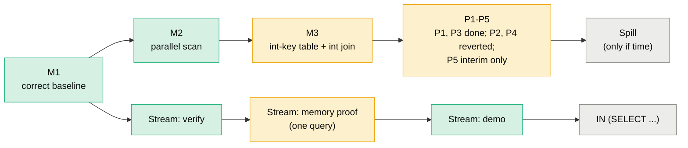

# Status board

One page that says what is true **today** (2026-11-07, Phase 0 merged, Phase 1 started; performance rows as of the interim 1e8 run of [production-readiness.md](production-readiness.md#phase-0-audit-and-baseline-about-3-4-days)), how we know, and what is open.
Legend: ✅ verified · 🟡 partly verified or narrow scope · ⚪ not done / not measured · ❌ failed

## Milestones

| Milestone | State | Evidence |
|---|---|---|
| M1 correct baseline (single-thread scan, hash agg/join, difftest) | ✅ | [BENCHMARKS](../BENCHMARKS.md), [TEST-002](testing.md) |
| M2 parallel chunked scan, fixed-order merge | ✅ | [EXP-003](experiments/003-parallel-chunked-scan.md) |
| Quote-free fast path | ✅ | [EXP-002](experiments/002-quote-free-fast-path.md) |
| Integer-key aggregation, partition-wise merge | ✅ merged | [EXP-004](experiments/004-integer-key-aggregation.md) |
| **P1** Diagnose superlinear scaling (Q3, Q5, Q9) | ✅ done (EXP-006): per-chunk table allocation explains about a quarter of Q3/Q5 and none of Q9; Q9 is the join table; Q5 is the per-chunk DISTINCT sets (EXP-009 profile) | [EXP-006](experiments/006-scaling-diagnosis.md), [EXP-009 profile](experiments/009-q5-profile.md) |
| **P2** Adaptive chunk size / aggregation table reuse | ⚪ adaptive chunk size not built; ❌ the table-reuse alternative was reverted (EXP-007): kill rule not met on the container (-11% on Q3); patch kept, not re-measured on the M3 Pro | [EXP-007](experiments/007-table-reuse.md) |
| **P3** Integer-keyed parallel join table | ✅ merged (EXP-008, re-measured on M3 Pro in EXP-008b): Q9 at 1e8 85.4 s → 14.6 s; now 2.95x DuckDB, Q8 1.37x. Direct-address array and probe prefetch still open | [EXP-008](experiments/008-int-join.md), [EXP-008b](experiments/008b-int-join-mac.md), [BENCHMARKS](../BENCHMARKS.md) "Interim, after EXP-008" |
| **P4** Per-worker `COUNT(DISTINCT)` sets | ❌ reverted (EXP-009 step 2): Q5 1.47x at 5e7, below the 1.5x bar; next: inline `i64` keys / bitset (ADR-0004) | [EXP-009](experiments/009-distinct-per-thread.md) |
| **P5** Final 1e8 benchmark (warm + cold), claims C12/C13 | 🟡 interim warm run done 2026-11-01 (qe ties or wins Q1-Q3, Q6, Q7 at 0.75-0.91x; loses Q4 4.04x, Q5 3.13x, Q9 2.95x, Q8 1.37x); cold run not done (needs `sudo purge`) | [BENCHMARKS](../BENCHMARKS.md) "Interim, after EXP-008" |
| M4 eager aggregation, M5 fused loops | ⛔ dropped for now | Q7 already ties DuckDB (0.95x); scan-bound queries tie (Q1, Q2, Q6) |
| M6 columnar cache (`--cache`) | ⛔ dropped for now | helps repeat runs only; cold path must be fast; stale-cache risk |
| Spill (Grace hash partitioning) | ⚪ deferred, only if time remains after P5 | robustness, not speed |
| **Phase 0** audit and baseline (production-readiness §12, tasks 0.1-0.7) | ✅ merged in PR #7 (2026-11-02), CI green on ubuntu and macos; gate met | [sql-surface.md audit](sql-surface.md#phase-0-audit-2026-11-02), `tests/surface_audit.rs`, `.github/workflows/ci.yml` |
| **Phase 1, task 1.1** schema inference (SRC-03) | 🟡 first cut 2026-11-07: plain CSVs run without `schema.toml`; header + first 1 MiB, `i64`/`f64`/`date`/`str`; `schema.toml` wins; late misfit is an error with a hint. Not yet: `DESCRIBE`, `bool`/`decimal` inference, mid-file samples, inference corpus | [ADR-0007](adr/0007-schema-inference.md), `tests/infer.rs` (5 tests, mutation-checked: I64+F64→I64 widening fails 3 tests), regression C07a now returns rows |
| **Phase 1, task 1.3** `SELECT DISTINCT`, `SUM/AVG(DISTINCT)` (AGG-03, AGG-04) | ✅ 2026-11-07: DISTINCT rewritten to GROUP BY the select list; SUM/AVG(DISTINCT) decode the distinct-key set (f64 sorted before Kahan sum, thread-independent). Still ⛔: DISTINCT combined with GROUP BY/HAVING/aggregates | `surface_audit::agg03_agg04_distinct` (vs SQLite), difftest generator now emits both; mutation-checked (ignoring DISTINCT, and AVG dividing by n+1, each fail difftest, regression and surface audit) |

## Streaming plan ([CLAUDE.md](../CLAUDE.md))

| Step | State | Evidence |
|---|---|---|
| 1. Verify streaming (tests, diff against file mode) | ✅ | [TEST-002](testing.md), [TEST-004](testing.md), [TEST-005](testing.md) |
| 2. Memory proof vs DuckDB at 1x/2x/5x/10x | 🟡 one query, reconstructed data | [EXP-005-stream](experiments/005-stream-memory.md) |
| 3. Tricky-input tests (quoted newlines, CRLF, byte-dribbled reads, tiny blocks) | ✅ | [TEST-004](testing.md) |
| 4. Demo: `gunzip -c ... \| qe --stdin` side by side with DuckDB | ✅ `./demo.sh` (`qe-demo`: live dashboard, recorded replay); runs the EXP-005 query on both engines at once and checks the outputs match | [demo notes](../README.md#live-demo), recordings `docs/experiments/data/demo-live-{1x,5x}.jsonl` |
| 5. `IN (SELECT ...)` as a real semi-join | ⚪ optional, not started | |

## Claims ledger

Every claim we are willing to make, its scope, and the evidence. Anything not in this table is not claimed.

| # | Claim | Scope | State | Evidence |
|---|---|---|---|---|
| C1 | `qe --stdin` peak RSS stays at about 42 MiB while piped input grows from 375 MB to 3.7 GB | one query (50-id join), one reconstructed data shape, 4-core Xeon container, `--threads 1` | ✅ | [EXP-005-stream](experiments/005-stream-memory.md), raw: `docs/experiments/data/exp005-stream-raw.jsonl` |
| C2 | `qe --stdin` creates no temp files | same | ✅ (temp dir sampled every 20 ms) | same |
| C3 | DuckDB 2.0.0 piped spills 237 MiB to 5.4 GiB of temp as input grows; by filename it spills none | same, `memory_limit=256MB`, 1 thread | ✅ | same |
| C4 | `qe` output equals DuckDB's output on that query | multiset of rows, every size, 3 runs | ✅ | same |
| C5 | Stream mode returns the same rows and error text as file mode | tests in `tests/stream.rs` and difftest stream configurations (large run: seeds 1000-1002, 4096-byte blocks, 8,154 stream comparisons, 2026-11-02) | ✅ | [TEST-002, TEST-004](testing.md) |
| C6 | File-mode results match SQLite on random queries | difftest, 3 file configurations; large run seeds 1000-1002, 4,500 queries, 2026-11-02 | ✅ | [TEST-002](testing.md) |
| C7 | Results never depend on `--threads` or `--chunk-bytes` | file mode, tests up to 11 threads; one full-size one-off | ✅ | [TEST-003](testing.md), [EXP-003](experiments/003-parallel-chunked-scan.md) |
| C8 | File mode is 2.4–5.9x faster than M1 on the nine benchmark queries | Apple M3 Pro, warm cache, 1e7 rows | ✅ | [BENCHMARKS](../BENCHMARKS.md) |
| C9 | On the streaming query, `qe` wall time is lower than DuckDB's (piped: 4.8 s vs 69.8 s at 10x; by filename: 4.8 s vs 7.0 s; ratio 14.6x on the Linux container; re-run on an M3 Pro with DuckDB 2.0.0: 2.5 s vs 15.0 s at 10x, ratio 6.0x) | this query only, 1 thread each; memory and temp claims reproduced on a second machine, the 14.6x wall ratio did not (6.0x) | 🟡 not a general speed claim | [BENCHMARKS](../BENCHMARKS.md) |
| C10 | Memory is bounded for **any** streamed query | | ❌ **not claimed**: group tables and join build sides grow with their own size | [ADR-0002](adr/0002-stream-first-direction.md) |
| C11 | `f64` sums are bit-identical between stream mode and file mode | | ⚪ not tested (tolerance 1e-9 only) | [testing: gaps](testing.md#known-gaps) |
| C12 | `qe` is faster than DuckDB on file mode | ❌ **not true at 1e8**: warm, all cores, min wall, qe wins only Q1, Q2, Q6, Q7 (0.79-0.95x of DuckDB's time, Q7/Q1/Q6 within about 10%, a 3-run figure); loses Q3 3.0x, Q4 3.6x, Q5 3.5x, Q8 1.6x, Q9 16x. At 1 thread qe wins only Q2 (0.88x) | 1e8 rows (5.55 GB per table), Apple M3 Pro 18 GiB, DuckDB 2.0.0, 3 runs, queries Q1-Q9 of `bench/run.py`; swap was in use | [BENCHMARKS](../BENCHMARKS.md) |
| C13 | Cold-cache performance | | ⚪ not measured yet (needs `sudo purge`; harness `file_vs_duckdb.py cold` is ready) | [BENCHMARKS](../BENCHMARKS.md) |
| C14 | The reconstructed data matches the issue's data | | ⚪ it is our reconstruction; re-run with the issue's own generator | [EXP-005-stream](experiments/005-stream-memory.md#caveats) |
| C15 | Every row of the SQL surface table has a tested state (no 🟡): ✅ 39, ⛔ 30, ❌ 32 (4 of them capability rows), mixed 4 | as of `phase-0-audit`; ⛔ means the error contains `unsupported` | ✅ | [sql-surface.md audit](sql-surface.md#phase-0-audit-2026-11-02), `tests/surface_audit.rs` (12), `crates/cli/tests/surface_audit_cli.rs` (2 + 1 ignored) |
| C16 | Every supported 🟡 feature of the audit (TYP-10, PRJ-06 `SELECT *`, FLT-01 `!=`, JN-04, JN-05, JN-07) equals SQLite | 5 configurations each, small hand-made tables without quoted newlines | ✅ | `tests/surface_audit.rs` |
| C17 | CI runs fmt, clippy and tests on every push and PR, Linux and macOS | | ⚪ workflow committed, **not yet run on GitHub** | `.github/workflows/ci.yml` |

## Where we lose (file mode, 1e8 rows, warm, min wall, qe time / DuckDB time)

| Query | all cores | 1 thread | Likely area (not yet diagnosed, hypotheses only) |
|---|---|---|---|
| Q9 join big (1e8 x 1e8) | 16.3x | 5.9x | serial join build |
| Q4 group id3 (63M groups) | 3.6x | 2.5x | high-cardinality GROUP BY |
| Q5 group str id4 + COUNT(DISTINCT) | 3.5x | 2.5x | string keys / distinct |
| Q3 group id2 (1e4 groups) | 3.0x | 1.6x | per-chunk partial tables (RSS +1.7 GB vs Q2); was equal to Q2 at 1e7 |
| Q8 join medium + grp | 1.6x | 1.9x | not diagnosed |
| Q1 at 1 thread, Q6, Q7 at 1 thread | 1.1-1.3x | | scan parse cost per core |

## Known limits

| Limit | Kind |
|---|---|
| The stream is parsed on one thread | design (ADR-0002); later |
| No `IN (SELECT ...)`; `JOIN` equals a semi-join only for unique lookup keys | scope |
| Stream cannot be the right side of a `LEFT JOIN`, never a build side, one scan per query | design |
| A row longer than 64 MiB is an error in stream mode | design |
| `t.*` and `*` mixed with other select items are not supported (a bare `SELECT *` is: `surface_audit::prj06_select_star`) | scope |
| An input file that changes during a query is not detected; truncating a memory-mapped file under a scan kills the process with SIGBUS (observed by accident in the Phase 0 audit) | robustness, production-readiness §9.1, ADR-0006 |
| BUG-0001: a second positional CLI argument silently replaces the first (`qe "SELECT a" "SELECT b"` runs only b, exit 0) | bug, `surface_audit_cli::bug_0001_extra_positional_argument_is_an_error` (`#[ignore]`) |
| Unordered group order can differ between the tree merge and the partition-wise merge (still thread-independent) | stated trade-off, [EXP-004](experiments/004-integer-key-aggregation.md) |
| The 1e7 × 1e7 join builds its table serially | performance, deferred |

## Open items

From [ADR-0002](adr/0002-stream-first-direction.md), the [testing gaps](testing.md#known-gaps) and `CLAUDE.md`:

- [ ] Re-run EXP-005-stream with the issue's own generator (the issue text was not reachable from the build environment).
- [ ] High-cardinality `GROUP BY` over a stream: measure how memory grows and document it.
- [ ] Bit-for-bit `f64` comparison, stream vs file mode.
- [ ] Integration test that spawns `qe --stdin` with a real pipe **and compares with file mode**. (Partly done: `crates/cli/tests/progress.rs` and `surface_audit_cli` spawn `qe --stdin` over an OS pipe, but compare only with themselves or with an expected error.)
- [x] Run the large difftest with the stream configurations for all seeds: done 2026-11-02 with `DIFFTEST_STREAM_BLOCK=4096`, all OK ([TEST-002](testing.md#test-002-differential-test-vs-sqlite)). Still open: the same at 37-byte blocks (~1 h).
- [ ] Demo script: `gunzip -c ... | qe --stdin` next to DuckDB.
- [ ] Decide `IN (SELECT ...)` (optional).
- [ ] `docs/strategy.md` is referenced by `CLAUDE.md` but is not in the repo; export it or drop the reference.
- [ ] Rename the join experiment to avoid two "EXP-005" IDs.
- [ ] `CLAUDE.md` open questions (how judges time queries, data format, hardware) may no longer apply.

From Phase 0 (2026-11-02):

- [ ] Push `phase-0-audit` and open a PR so CI runs once; the Phase 0 gate needs it (C17).
- [ ] **D-6 licence** (owner's decision; recommendation dual MIT / Apache-2.0). No `LICENSE` file exists.
- [ ] Accept or amend ADR-0005 (reference dialect) and ADR-0006 (memory definition); both are Proposed.
- [ ] Fix BUG-0001 (extra positional argument) and un-ignore its test.
- [ ] 6 clippy warnings left (CI runs clippy without `-D warnings`): `needless_range_loop` in `crates/demo/src/ui.rs:124`, `crates/cli/src/shell.rs:162`, `crates/engine/src/storage/csv/mod.rs:179` and `:397`; `chunks_exact_to_as_chunks` in `crates/engine/src/exec/hash.rs:21`; `len_without_is_empty` on `CsvSource`.
- [ ] Turn the 28 ❌ feature rows into ⛔ (`unsupported SQL feature: X`) before Phase 1 closes, starting with the ones that were ⛔ in the table but failed the audit: `NOT IN`, `ILIKE`, `LIMIT m, n`, boolean comparison, and the two stream limits (SRC-09, SRC-10).
- [ ] Recover the real demo query (R-0001); the 16 candidates are in `tests/regression/demo_candidates.sql`.
- [ ] `rust-toolchain.toml` (listed in production-readiness 0.5, not in this Phase 0 brief): CI uses latest stable, so new clippy lints can appear without a code change.
- [ ] The audit tables have no quoted fields, so `surface_audit` stays green under mutation M-2; quoting is covered by TEST-001..005 instead.

## Decisions taken without the team (revisit if wrong)

- Float results are thread-count independent (fixed 16 MiB chunks, fixed merge tree).
- A `"` inside an unquoted field is a hard error (needed for exact parallel splitting and for the stream cut rule).
- **The streaming implementation was re-written** from ADR-0002 after the original commit was lost; it is not the team's original code. All stream claims above refer to the re-written code.
- The stream block default (4 MiB) and queue (16 pieces) are first choices, not tuned.
