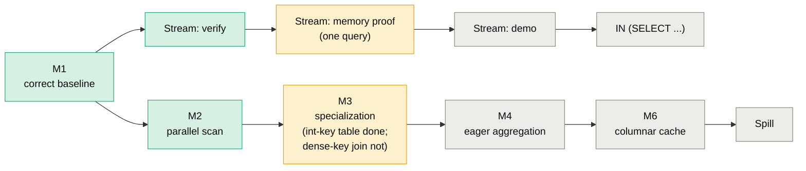

# Status board

One page that says what is true **today** (2026-10-31), how we know, and what is open.
Legend: ✅ verified · 🟡 partly verified or narrow scope · ⚪ not done / not measured · ❌ failed

## Milestones

| Milestone | State | Evidence |
|---|---|---|
| M1 correct baseline (single-thread scan, hash agg/join, difftest) | ✅ | [BENCHMARKS](../BENCHMARKS.md), [TEST-002](testing.md) |
| M2 parallel chunked scan, fixed-order merge | ✅ | [EXP-003](experiments/003-parallel-chunked-scan.md) |
| Quote-free fast path | ✅ | [EXP-002](experiments/002-quote-free-fast-path.md) |
| Integer-key aggregation, partition-wise merge | ✅ merged | [EXP-004](experiments/004-integer-key-aggregation.md) |
| M3 rest: dense-key array join, parallel join build | ⚪ deferred (EXP-005, "Later") | [ADR-0001](adr/0001-parallel-and-fast-path-execution.md) |
| M4 eager aggregation, M5 fused loops | ⚪ not started | |
| M6 columnar cache (`--cache`) | ⚪ not implemented | |
| Spill (Grace hash partitioning) | ⚪ not implemented | |

## Streaming plan ([CLAUDE.md](../CLAUDE.md))

| Step | State | Evidence |
|---|---|---|
| 1. Verify streaming (tests, diff against file mode) | ✅ | [TEST-002](testing.md), [TEST-004](testing.md), [TEST-005](testing.md) |
| 2. Memory proof vs DuckDB at 1x/2x/5x/10x | 🟡 one query, reconstructed data | [EXP-005-stream](experiments/005-stream-memory.md) |
| 3. Tricky-input tests (quoted newlines, CRLF, byte-dribbled reads, tiny blocks) | ✅ | [TEST-004](testing.md) |
| 4. Demo: `gunzip -c ... \| qe --stdin` side by side with DuckDB | ✅ `./demo.sh` (`qe-demo`: live dashboard, recorded replay); runs the EXP-005 query on both engines at once and checks the outputs match | [demo notes](../README.md#live-demo), recordings `docs/experiments/data/demo-live-{1x,5x}.jsonl` |
| 5. `IN (SELECT ...)` as a real semi-join | ⚪ optional, not started | |

## Claims ledger

Every claim we are willing to make, its scope, and the evidence. Anything not in this table is not claimed.

| # | Claim | Scope | State | Evidence |
|---|---|---|---|---|
| C1 | `qe --stdin` peak RSS stays at about 42 MiB while piped input grows from 375 MB to 3.7 GB | one query (50-id join), one reconstructed data shape, 4-core Xeon container, `--threads 1` | ✅ | [EXP-005-stream](experiments/005-stream-memory.md), raw: `docs/experiments/data/exp005-stream-raw.jsonl` |
| C2 | `qe --stdin` creates no temp files | same | ✅ (temp dir sampled every 20 ms) | same |
| C3 | DuckDB 2.0.0 piped spills 237 MiB to 5.6 GB of temp as input grows; by filename it spills none | same, `memory_limit=256MB`, 1 thread | ✅ | same |
| C4 | `qe` output equals DuckDB's output on that query | multiset of rows, every size, 3 runs | ✅ | same |
| C5 | Stream mode returns the same rows and error text as file mode | tests in `tests/stream.rs` and difftest stream configurations | ✅ | [TEST-002, TEST-004](testing.md) |
| C6 | File-mode results match SQLite on random queries | difftest, 3 file configurations | ✅ | [TEST-002](testing.md) |
| C7 | Results never depend on `--threads` or `--chunk-bytes` | file mode, tests up to 11 threads; one full-size one-off | ✅ | [TEST-003](testing.md), [EXP-003](experiments/003-parallel-chunked-scan.md) |
| C8 | File mode is 2.4–5.9x faster than M1 on the nine benchmark queries | Apple M3 Pro, warm cache, 1e7 rows | ✅ | [BENCHMARKS](../BENCHMARKS.md) |
| C9 | On the streaming query, `qe` wall time is lower than DuckDB's (piped: 4.8 s vs 69.8 s at 10x; by filename: 4.8 s vs 7.0 s; ratio 14.6x on the Linux container; re-run on an M3 Pro with DuckDB 2.0.0: 2.5 s vs 15.0 s at 10x, ratio 6.0x) | this query only, 1 thread each; memory and temp claims reproduced on a second machine, the 14.6x wall ratio did not (6.0x) | 🟡 not a general speed claim | [BENCHMARKS](../BENCHMARKS.md) |
| C10 | Memory is bounded for **any** streamed query | | ❌ **not claimed**: group tables and join build sides grow with their own size | [ADR-0002](adr/0002-stream-first-direction.md) |
| C11 | `f64` sums are bit-identical between stream mode and file mode | | ⚪ not tested (tolerance 1e-9 only) | [testing: gaps](testing.md#known-gaps) |
| C12 | `qe` is faster than DuckDB on file mode | | ⚪ not measured | |
| C13 | Cold-cache performance | | ⚪ not measured | |
| C14 | The reconstructed data matches the issue's data | | ⚪ it is our reconstruction; re-run with the issue's own generator | [EXP-005-stream](experiments/005-stream-memory.md#caveats) |

## Known limits

| Limit | Kind |
|---|---|
| The stream is parsed on one thread | design (ADR-0002); later |
| No `IN (SELECT ...)`; `JOIN` equals a semi-join only for unique lookup keys | scope |
| Stream cannot be the right side of a `LEFT JOIN`, never a build side, one scan per query | design |
| A row longer than 64 MiB is an error in stream mode | design |
| `SELECT *` and `t.*` are not supported | scope |
| Unordered group order can differ between the tree merge and the partition-wise merge (still thread-independent) | stated trade-off, [EXP-004](experiments/004-integer-key-aggregation.md) |
| The 1e7 × 1e7 join builds its table serially | performance, deferred |

## Open items

From [ADR-0002](adr/0002-stream-first-direction.md), the [testing gaps](testing.md#known-gaps) and `CLAUDE.md`:

- [ ] Re-run EXP-005-stream with the issue's own generator (the issue text was not reachable from the build environment).
- [ ] High-cardinality `GROUP BY` over a stream: measure how memory grows and document it.
- [ ] Bit-for-bit `f64` comparison, stream vs file mode.
- [ ] Integration test that spawns `qe --stdin` with a real pipe.
- [ ] Run the large difftest with the stream configurations for all seeds (use bigger blocks so it finishes).
- [ ] Demo script: `gunzip -c ... | qe --stdin` next to DuckDB.
- [ ] Decide `IN (SELECT ...)` (optional).
- [ ] `docs/strategy.md` is referenced by `CLAUDE.md` but is not in the repo; export it or drop the reference.
- [ ] Rename the join experiment to avoid two "EXP-005" IDs.
- [ ] `CLAUDE.md` open questions (how judges time queries, data format, hardware) may no longer apply.

## Decisions taken without the team (revisit if wrong)

- Float results are thread-count independent (fixed 16 MiB chunks, fixed merge tree).
- A `"` inside an unquoted field is a hard error (needed for exact parallel splitting and for the stream cut rule).
- **The streaming implementation was re-written** from ADR-0002 after the original commit was lost; it is not the team's original code. All stream claims above refer to the re-written code.
- The stream block default (4 MiB) and queue (16 pieces) are first choices, not tuned.
