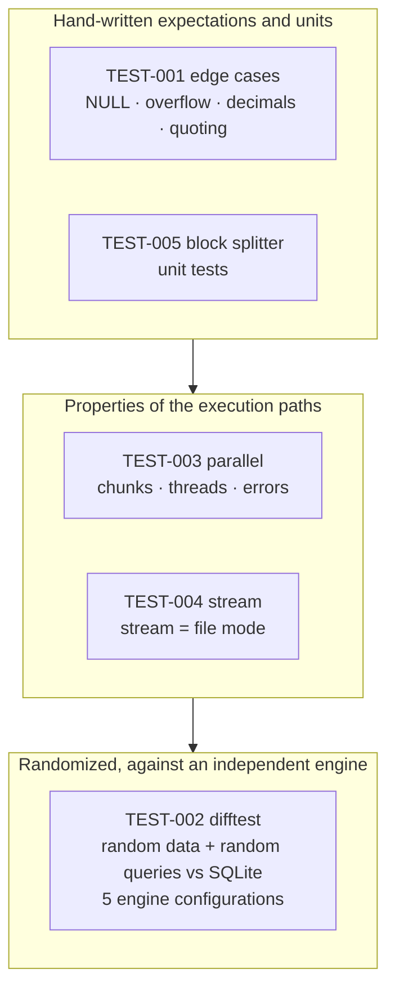
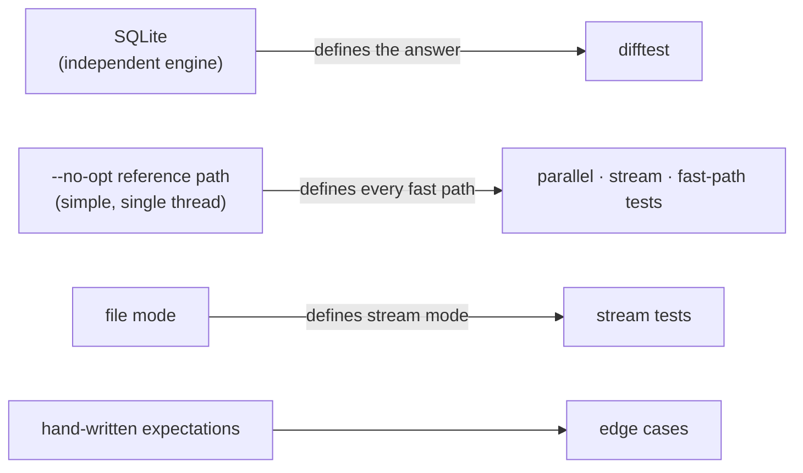

# Testing

The tests are documented the way the experiments are: every suite is a small piece of research with a **claim**, a **falsifier** (what would prove it wrong), a **method**, an **oracle** (what "right" means), **results**, **falsification evidence** (we broke the code on purpose and the test failed), and **threats to validity**. "Green" means little unless the suite is known to be able to go red.

**Contents:** [Pyramid](#the-pyramid) · [Run](#run) · [TEST-001 edge cases](#test-001-edge-cases) · [TEST-002 difftest](#test-002-differential-test-vs-sqlite) · [TEST-003 parallel](#test-003-parallel-scan-properties) · [TEST-004 stream](#test-004-stream-mode-equals-file-mode) · [TEST-005 splitter](#test-005-block-splitter-unit-tests) · [Falsification log](#falsification-log) · [Coverage matrix](#coverage-matrix) · [Gaps](#known-gaps) · [Template](#template)

## The pyramid



Three kinds of oracle keep the suite honest:



## Run

```bash
cargo test                                          # 23 tests + 1 ignored, ~45 s in debug
cargo test --test stream                            # one suite
cargo test --release --test difftest -- --ignored  # large randomized run (env: DIFFTEST_SEED / ROWS / QUERIES)
```

Current state (2026-10-31): `cargo test` → **23 passed, 0 failed, 1 ignored** (the large difftest), no warnings.

| Suite | File | Tests |
|---|---|---|
| Unit (engine) | `crates/engine/src/storage/csv/stream.rs` | 2 |
| TEST-001 | `tests/edge_cases.rs` | 9 |
| TEST-002 | `tests/difftest.rs` | 1 (+1 ignored) |
| TEST-003 | `tests/parallel.rs` | 5 |
| TEST-004 | `tests/stream.rs` | 6 |

---

## TEST-001: edge cases

- **Claim.** The semantic traps in `CLAUDE.md` behave exactly as specified: NULLs, CSV quoting, numeric exactness, loud errors.
- **Falsifier.** Any listed case returning a different value, or an error with vague text.
- **Method.** Small hand-written files and queries with hand-written expected values. Includes the cross-path test `default_and_reference_paths_agree_on_tricky_files` (13 awkward files × 6 queries).
- **Oracle.** The expected value written in the test.
- **Tests.**

| Test | What it pins down |
|---|---|
| `quoting_newlines_crlf_and_missing_final_newline` | RFC 4180, embedded newlines, CRLF, no final newline |
| `null_semantics_in_aggregates_and_groups` | `COUNT(*)` vs `COUNT(col)`, all-NULL `SUM`, one NULL group |
| `null_keys_never_join` | NULL join keys never match |
| `empty_table_aggregates` | aggregates over header-only input |
| `decimals_are_exact_and_avg_is_not_integer_division` | scaled-`i64` decimals, `AVG` |
| `sum_overflow_is_an_error` | integer `SUM` in `i128`, error on narrowing overflow |
| `errors_are_loud_and_specific` | unknown table/column, ragged rows, bad numbers, row numbers |
| `default_and_reference_paths_agree_on_tricky_files` | CRLF, blank lines, quote only on the last line, stray `\r` at EOF, bad numbers in read and unread columns; equal results **and** equal error text |
| `output_formatting_of_numbers_and_dates` | extreme integers, scales 0/2/18, negative decimals, dates before 1970 |

- **Result.** 9/9 pass.
- **Threats.** Expectations are written by the same people who wrote the engine; cases are hand-picked. This is why TEST-002 exists.

---

## TEST-002: differential test vs SQLite

- **Claim.** For random data and random queries in the supported SQL, every engine configuration returns what SQLite returns.
- **Falsifier.** One query where any configuration differs from SQLite beyond the comparison rules, or errors where SQLite does not.
- **Method.** A seeded generator makes three tables (`facts`, `dim`, `other`; types `i64`, `f64`, decimal, `str`, `date`, with NULLs) and random queries: expressions, comparisons, `IS [NOT] NULL`, aggregates, `GROUP BY`, `HAVING`, `ORDER BY`, `LIMIT`, `INNER`/`LEFT JOIN`. The **same in-memory rows** are written to CSV (so the engine uses its real parser) and inserted into SQLite, so the test needs no CSV parser of its own. Odd seeds write quote-free files (exercises the fast path); even seeds write the full zoo (quotes, embedded newlines, CRLF).
- **Configurations per query.**

| # | Configuration | Why |
|---|---|---|
| 1 | default (parallel, 16 MiB chunks) | what users run |
| 2 | `--no-opt` reference | the oracle for fast paths |
| 3 | 3 threads, 256-byte chunks, forced partitioned merge | splits land inside quoted fields and CRLF pairs; every aggregation strategy is exercised |
| 4 | stream, 1–300 byte random reads, 37-byte blocks | stream mode with block boundaries everywhere |
| 5 | stream + `--no-opt` | the serial stream path |

  For the stream configurations the FROM table is streamed. Queries that hit a documented streaming limit (stream on the right of a `LEFT JOIN`, or the same table twice) are **skipped and counted**, not hidden.
- **Oracle.** SQLite. Comparison rules (from `CLAUDE.md`): NULL = NULL; unordered results compare as multisets; ordered results compare in order; floats with relative tolerance 1e-9; integers exactly.
- **Results.**

| Run | Queries | Configurations | Outcome |
|---|---|---|---|
| `difftest_small`, seeds 1–6, 300 rows | 1,500 | 5 | all OK; stream runs: **2,718 compared, 282 skipped** (documented limits) |
| large, seed 1000, 20,000 rows | 1,500 | 5 | OK; 2,718 compared, 282 skipped |
| large, seeds 1001–1002 | not run with the stream configurations | | the run takes ~20 min per seed because of the 37-byte blocks; it was stopped after seed 1000 |
| earlier large runs (EXP-002, EXP-003), seeds 1000–1002, 1,000 queries each | 3,000 | 2–3 file configurations | all OK (before the stream configurations existed) |

- **Threats to validity.**
  - Small data (300 rows) in the default run; the large run is slow and only partly repeated.
  - SQLite semantics define "right", so a shared misreading of SQL would pass; the rules in `CLAUDE.md` were chosen to match SQLite on purpose.
  - The generator reaches only the supported SQL; unsupported syntax is tested only by `errors_are_loud_and_specific`.
  - Stream configurations read from an in-memory `Dribble`, not an OS pipe.
  - Floats are compared with a tolerance, so **bit-identical** `f64` sums between stream and file mode are not tested here.

---

## TEST-003: parallel scan properties

- **Claim.** The chunk-parallel scan returns exactly the reference result for any chunk size and thread count, with the reference's error text.
- **Falsifier.** A chunk size, thread count or file where the parallel result or error differs from `--no-opt`.
- **Method and tests.**

| Test | Method |
|---|---|
| `every_chunk_size_gives_the_reference_result` | every chunk size 1–70 bytes (plus 97, 128, 255, 1000, 100,000) × 1 and 4 threads, on a CRLF file with quoted commas, `""`, embedded LF and CRLF, empty quoted fields and a quoted newline in the last row (no final newline) |
| `float_results_do_not_depend_on_thread_count` | 30,000 rows of wide-magnitude floats; sums, averages, min/max and unordered group order at 1, 2, 3, 5, 8, 11 threads must be **bit-identical** |
| `errors_in_parallel_chunks_use_reference_text` | a bad value in a late chunk reports `row 502`, the same text as `--no-opt`; a stray quote is rejected consistently |
| `integer_like_group_keys_match_reference_including_order` | 6,000 rows of `i64` / decimal / date keys with NULLs, forcing table growth, many tiny chunks |
| `partitioned_merge_matches_reference_and_is_thread_independent` | the partition-wise merge forced on (`agg_partition_groups = 0`) at several chunk sizes and thread counts |

- **Oracle.** `--no-opt` (single thread, generic scanner).
- **Result.** 5/5 pass.
- **Falsification.** See M-1 in the [log](#falsification-log).
- **Threats.** The determinism test uses 30,000 rows; the full-size check (1e7 rows, byte-identical output at 1, 11 and default threads on 5 queries) was a one-off in [EXP-003](experiments/003-parallel-chunked-scan.md), not an automated test.

---

## TEST-004: stream mode equals file mode

- **Claim.** `--stdin` returns the same rows and the same error text (apart from `<stdin>`) as reading the same bytes by file name, for any read sizes and any block size.
- **Falsifier.** Any input, read pattern or block size where results or errors differ from file mode.
- **Method.** Each query is run in file mode (`--no-opt` and default), then through `run_collect_stream` with the same bytes. Read patterns: a `Dribble` reader that returns 1–300 random bytes per `read` (seeded), and 1 byte per `read`. Block sizes: 1–70, 97, 128, 255, 1000 bytes and 16 MiB. Both `no_opt` settings.
- **Tests.**

| Test | What it covers |
|---|---|
| `tricky_csv_every_block_size_and_read_pattern` | the CSV from TEST-003 (quoted commas, `""`, embedded LF/CRLF, empty quoted = NULL, no final newline, quoted newline in the last row) × SELECT, `COUNT`/`SUM`/`GROUP BY`, `WHERE`, `LIMIT`, `HAVING`/`ORDER BY` |
| `odd_inputs_match_file_mode` | header-only (with and without newline), empty input (error), BOM, blank lines, CRLF-only, missing final newline, ragged row, stray quote, unterminated quote |
| `bad_value_late_in_the_stream_reports_the_file_mode_row` | `row 3002`, after thousands of rows containing quoted newlines; error text equals file mode with the path replaced by `<stdin>` |
| `joins_with_the_stream_as_probe_side` | dimension file + streamed fact table: stream on the left and on the right of an INNER join, LEFT JOIN with the stream on the left, group by over a join, anti-join pattern (`IS NULL`); NULL and unmatched keys |
| `documented_stream_errors_are_clear` | stream on the right of a `LEFT JOIN`; stream table used twice; stream table unused; unknown table |
| `limit_stops_an_endless_stream` | an infinite reader with `LIMIT 3` must finish (20 s timeout) in both engine modes: proves early exit and, indirectly, bounded buffering |

- **Oracle.** File mode (itself checked against SQLite in TEST-002).
- **Result.** 6/6 pass.
- **Falsification.** See M-2 in the [log](#falsification-log).
- **Threats.**
  - Readers are in-memory (`Cursor`, `Dribble`, an endless generator), not an OS pipe. The real pipe path was exercised by the EXP-005-stream benchmark (outputs equal DuckDB's at every size) but **there is no automated test that spawns `qe --stdin`**.
  - Row order for joins is compared as a sorted multiset (probe and build roles can reorder rows); other tests compare in order.
  - The memory bound itself is measured in [EXP-005-stream](experiments/005-stream-memory.md), not asserted by a test.

---

## TEST-005: block splitter unit tests

- **Claim.** `BlockSplitter` concatenates back to the exact input and cuts only after a newline outside quotes; an over-long row is an error.
- **Falsifier.** Any target/piece combination where the blocks do not concatenate to the input, a non-final block does not end in `\n`, or contains an odd number of quote bytes.
- **Method.** `blocks_concatenate_and_cut_outside_quotes`: input with quoted newlines, `""` and a final row without a newline, for every target 1–39 and piece 1–11. `long_row_is_an_error`: 5 MiB of one row with a 2 MiB limit.
- **Result.** 2/2 pass.
- **Falsification.** M-2 fails `blocks_concatenate_and_cut_outside_quotes`.

---

## Falsification log

A test that cannot fail proves nothing. Each entry breaks the code on purpose and records what went red, then reverts.

| ID | Mutation | Expected | Observed |
|---|---|---|---|
| M-1 | parallel splitter ignores quote state (`row_start_at_or_after(.., false)`) | quoted-newline tests fail | `difftest_small` failed with `unterminated quoted field` ([EXP-003](experiments/003-parallel-chunked-scan.md)); reverted |
| M-2 | stream `BlockSplitter::scan` ignores quote bytes (`if false && buf[at] == b'"'`) | stream tests with quoted newlines fail | 3 of 6 stream tests (`tricky_csv_…`, `odd_inputs_…`, `bad_value_late_…`) and the splitter unit test failed; `documented_stream_errors_are_clear`, `limit_stops_…` and `joins_…` passed because their data has no quoted newlines. The difftest was **not** re-run under this mutation. Reverted |
| P-1 | *(process, not code)* RSS measured from the benchmark harness | | the first EXP-005-stream run reported 341–666 MiB for every engine; the harness's own memory was inherited across `exec`. Discarded, harness fixed ([EXP-005-stream](experiments/005-stream-memory.md#caveats)) |

## Coverage matrix

Which invariant is checked where (see [architecture](architecture.md#invariants)).

| Invariant | 001 | 002 | 003 | 004 | 005 |
|---|:-:|:-:|:-:|:-:|:-:|
| Equals the `--no-opt` reference | ● | ● | ● | ● | |
| Independent of `--threads` / `--chunk-bytes` | | ● | ● | ● | ● |
| Stream = file mode | | ● | | ● | ● |
| NULL semantics | ● | ● | | ● | |
| CSV quoting, CRLF, newlines in quotes | ● | ● | ● | ● | ● |
| Stray quote is an error | ● | | ● | ● | |
| Exact decimals, overflow | ● | ● | | | |
| Same error text on every path | ● | | ● | ● | |
| Early exit on `LIMIT` | | ● | | ● | |
| Bit-identical `f64` across threads | | | ● | | |

● = checked there. An empty cell means not checked in that suite.

## Known gaps

| Gap | Why it matters | Idea |
|---|---|---|
| No automated test spawns `qe --stdin` with a real pipe | the CLI wiring (`Stdin`, flush per batch) is only exercised by the benchmark | integration test with `std::process::Command` and a piped stdin |
| `f64` sums stream vs file mode compared with tolerance only | file mode merges per-chunk partials in a fixed tree; stream adds in order | bit-for-bit comparison on wide-magnitude data |
| Memory bound is measured, not asserted | a regression would not turn a test red | a test with a tracking allocator or an RSS assertion on a long synthetic stream |
| Large difftest with stream configurations ran for 1 of 3 seeds | breadth | bigger blocks in the large run to make it faster, then all seeds |
| Generator covers only the supported SQL | by design | none |
| Stream tests use tiny data | block boundaries are covered, scale is not | the benchmark covers scale for one query |

## Template

Copy this when adding a suite.

```markdown
## TEST-NNN: <what it checks>
- **Claim.**      one sentence, falsifiable
- **Falsifier.**  what observation would prove the claim wrong
- **Method.**     data, queries, configurations, what varies
- **Oracle.**     what "right" means (SQLite, --no-opt, file mode, hand-written)
- **Result.**     counts, with the command that produced them
- **Falsification.** the mutation that made it fail (add a row to the log)
- **Threats.**    what this does not cover
```
